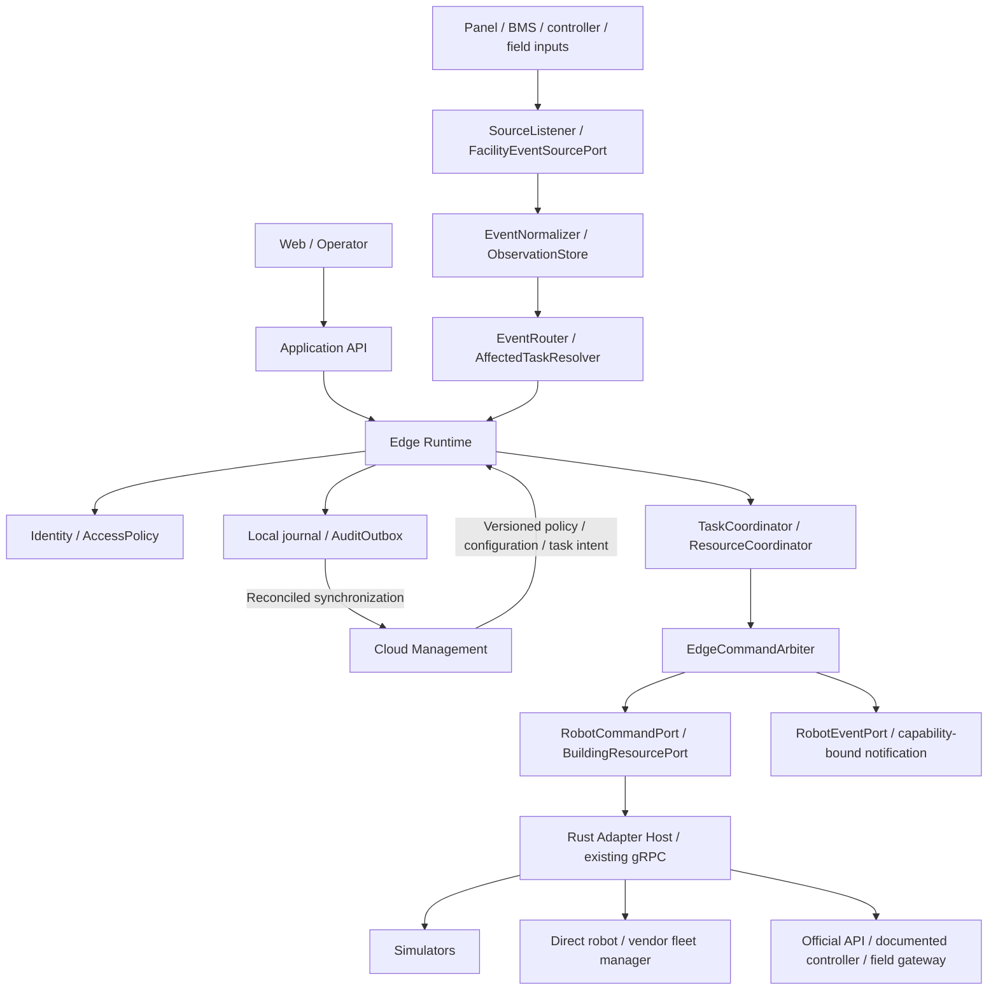

# Ürün kapsamı ve teknik yön

İnceleme tarihi: **2026-11-10**. Kod tabanı: `a976d449a29b670a9eef8d62cd020ec92cc58e11`.

Kapsam güncellemesi: **2026-11-11**. Tesis olay listener'ları, ayrı bildirim/komut yolları, genişletilmiş ekipman türleri ve profil tabanlı devreye alma aşağıda `PLANNED` olarak tanımlanmıştır; uygulama desteği eklenmemiştir. Önceki protokol sürüm araştırmasının tarihi yukarıdaki inceleme tarihidir; yeni donanım adaylarının kaynak tarihleri kendi satırlarında belirtilir.

Unloc kapsam incelemesi: **2026-11-12**. Resmî API belgeleri, kullanıcı gözlemi, hedef binada doğrulanacak yetenekler ve repodaki durum [Unloc erişim profili](#unloc-access) altında ayrı gösterilir. Uygulama, test, bağımlılık veya deployment değişikliği yoktur; gerçek kapı/anahtar/webhook işlemi ve dış taraflarla iletişim yapılmamıştır.

Acil durum kapsam güncellemesi: **2026-11-12**. [Robot koordinasyonu](#emergency-robot-coordination) ve [tatbikat tasarımı](use-cases.md#emergency-drill) yalnız `PLANNED` kapsamıdır; yeni simülatör, adaptör veya test uygulanmamıştır.

Güvenlik test planı incelemesi: **2026-11-16**, GitHub `main` kod tabanı `ed6c564113bcbcd5d43bab0ce21d3942af98a168`. Tek robot/tek simüle kapı için [senaryolar, mevcut test eşlemesi ve issue taslakları](use-cases.md#door-security-tests) hazırlanmıştır. 22 Rust/23 Kotlin test tanımı kaynakta yeniden sayılmış; uygulama testleri bu görevde çalıştırılmamıştır. Yeni auth/test kodu eklenmemiştir.

**2026-11-19** güncellemesinde Nuki, Awaio ve Amido [erişim entegrasyonu yol haritasına](#access-provider-roadmap) eklendi. Özel robotlarla arama desteği [acil durum kapsamına](#emergency-robot-coordination) sonraki aşama adayı olarak işlendi. Tüm yeni adaylar `PLANNED` durumundadır.

Bu belge ürün kapsamı, hedef mimari, entegrasyon sınırları ve kabul kriterlerinin tek referansıdır. **Uygulanan özellik listesi değildir.** Bu görevde uygulama kodu, framework, protokol sözleşmesi veya bağımlılık değiştirilmemiştir. Repo ve üst dizinlerde `AGENTS.md` bulunmamıştır.

- [README](../README.md): mevcut projeyi çalıştırma ve doğrulama.
- [Kullanım senaryoları](use-cases.md): bugün çalışan simülasyonların durumları/REST uçları ve onlardan ayrı etiketlenen planlı saha senaryoları. Bu belge ayrıntılı case adımlarını tekrar tarif etmez.
- Aşağıdaki **öneriler** kabul edilmiş saha tasarımı veya cihaz uyumluluk taahhüdü sayılmaz. Donanım modeli, firmware ve tesis prosedürü bilinmeyen yerler açık bırakılmıştır.

## 1. Ürün ve ilk pazar kapsamı

Ürün, farklı robot ve bina/saha ekipmanlarını **kimlik, erişim, kaynak koordinasyonu ve görev akışı** üzerinden birleştiren yazılım ve gerektiğinde saha donanımıdır. Müşteri adayları robot üreticileri, robotik entegratörleri ve robot kullanan tesislerdir. İlk müşterinin hangisi olduğu henüz belirlenmemiştir; MVP için tek tesisli bir entegratör pilotu **çalışma varsayımıdır**.

Platform; izinli kapı/kat/bölge kullanımı, geçiş sırası, rezervasyon, bekleme noktaları, desteklenen hareket hedefleri, hata yönetimi ve operatör devrini yönetir. Robotun lokal navigasyonu, motor kontrolü ve çarpışma önlemesi robotta kalır. Platformun tesis koordinasyonu bu yerel işlevlerin yerine geçmez.

Platform ayrıca tesis olaylarını **robotlardan bağımsız kaynaklardan** toplar: robotun yangın alarmını duyması veya doğrudan her bina protokolünü bilmesi beklenmez. Ürün sınırı; tesis bağlantısı, olay yönetimi, robot koordinasyonu ve gerektiğinde donanım/kurulumun birlikte sağlanmasıdır. Kapı/bariyer/turnike geçişleri, yolcu taşıma ekipmanının durum ve rota kısıtları, endüstriyel konveyörle malzeme aktarımı farklı capability ve görev sözleşmeleri gerektirir.

İlk ürün, sınırlı ve modellenmiş geçiş kaynaklarını koordine eder. Genel amaçlı sürekli uzay trafik planlayıcısı, her üreticiye hazır sürücü, bütün PLC'leri programlayan araç veya bina can güvenliği kontrolcüsü ilk MVP'nin kapsamı değildir. Yeni donanım geliştirmek her entegrasyonun önkoşulu değildir; belgelenmiş mevcut bir arayüz yeterliyse önce o kullanılır.

### Destek durumları

| Etiket | Anlam |
| --- | --- |
| `SIMULATED` | Açıkça etiketlenmiş sanal durum/olaylarla çalışır; saha kanıtı değildir |
| `IMPLEMENTED_UNVERIFIED` | Kod yolu mevcut; hedef donanımda uçtan uca doğrulanmamış |
| `PLANNED` | Yalnızca sözleşme/yol haritası önerisi; sürücü veya uyumluluk henüz yok |
| `FIELD_VERIFIED` | Belirli model, firmware, sürüm ve saha profili için kayıtlı kabul testi geçmiş |

**Şu an hiçbir entegrasyon `FIELD_VERIFIED` değildir.** Bir dokümanın veya şemanın okunması, robot/cihaz uyumluluk testi sayılmaz.

## 2. Koddan doğrulanan mevcut durum ve boşluklar

Mevcut yığın korunur: Spring Boot **3.5.7**, Kotlin **2.2.21**, JDK **21**, gRPC Java **1.76.0**; Rust/tonic **0.12**, prost **0.13**, Tokio; React **19.1.1**, TypeScript **5.9.2**, Vite **7.3.8**. Sürümler [backend](../backend/build.gradle.kts), [Rust manifesti](../robot-agent/Cargo.toml) ve [frontend manifestinde](../frontend/package.json) görülür. Rust manifestinin MSRV'si `1.85`, Docker derleyici imajı `1.93`'tür; bu görev bir yükseltme önermemektedir.

| Alan | Bugünkü kanıt | Hedefle arasındaki boşluk |
| --- | --- | --- |
| Süreçler | [Compose](../compose.yaml): frontend/nginx, Kotlin backend, Rust agent; Rust aynı süreçte dört gRPC service sunar | Ayrı edge/cloud rolü, cihaz yönetimi ve Greengrass paketi yok |
| Robot | [RobotService](../proto/robot.proto) yalnızca `GetStatus` ve `Stop`; pil/hız simülasyonda sabit | Hareket eden robot simülatörü, `NavigateTo`, `Wait`, `Resume`, `CancelTask`, görev/goal feedback ve capability profili yok |
| ROS 2 | [CLI adaptörü](../robot-agent/src/adapter.rs) sıfır `Twist` yayınlar; başarılı process exit `STOP_REQUESTED` olur | Abone kabulü, fiziksel duruş, navigation action, canlı telemetri veya saha doğrulaması yok |
| Kapı/asansör | [DoorSimulator](../robot-agent/src/door.rs), [ElevatorSimulator](../robot-agent/src/elevator.rs): manuel olaylarla bellekte ilerleyen singleton state machine'ler | Gerçek cihaz bağlantısı veya gerçek/simüle robot navigasyonu yok; `StartPassage` yalnızca durum değiştirir |
| Kaynak paylaşımı | Mutex ve `Busy` kontrolü eşzamanlı çağrıyı reddeder | Robot/task sahibine bağlı rezervasyon, kuyruk, öncelik, lease, bekleme noktası ve çoklu kaynak koordinasyonu yok |
| Alarm | [Ortak gate](../robot-agent/src/fire_alarm.rs) aktif demoları iptal eder; son sensör durumunu korur; temizleme devam ettirmez | Sabit demo politikasıdır; tesis prosedürü, harici alarm kaynağı ve fiziksel kurtarma doğrulaması yok |
| Kimlik/yetki | REST controller'ları doğrudan [RobotGateway](../backend/src/main/kotlin/dev/robotics/RobotGateway.kt) çağırır; gRPC `usePlaintext()` kullanır | Robot/user/service/gateway ayrımı, tenant/site, authentication, authorization, mTLS ve audit yok |
| Komut sahipliği | Robot stop mutex'i ve bina alarm gate'i süreç içi sıralama sağlar | `ControlAuthority`, planner owner, fencing ve manuel devir yok; başka ROS publisher'ı engellenmez |
| Mesaj güvenilirliği | `expectedState` aynı adımın hemen yinelenmesini reddeder; istemci deadline'ları var | Kalıcı `CommandId`, görev/olay kimliği, deduplication, sıra/boot bilgisi, outbox ve reconciliation yok |
| Telemetri | ROS'ta bilinmeyen pil/hız `null`; sanal kapı/kabin bilgisi phase'ten türetilir | Yanıt zamanı `observedAtUnixMs` yeni üretilir; gerçek sensör zamanı/freshness kanıtı değildir. Source time, quality ve stale/unknown modeli yok |
| Tesis listener'ları | Alarm yalnızca simülasyon REST işlemiyle tetiklenir; kaynak aboneliği/polling veya panel/BMS listener'ı yok | Bağımsız olay toplama, normalization, source health, zone/robot hedefleme ve kalıcı event/effect deduplication yok |
| Devreye alma | Web mevcut demoları işletir; device-profile onboarding wizard'ı yok | Model/firmware/profil, sinyal eşleme, kontrollü saha testleri ve onaylı configuration publishing yok |
| Kalıcılık | Domain ve alarm durumu bellekte; restart başlangıca döndürür | Görev/rezervasyon kurtarma, alarmı kaynaktan yeniden doğrulama ve kalıcı audit yok |
| Haritalar | Asansör için `0..5` tamsayı katlar | Tesis/kat kimliği, harita sürümü, frame, birim ve kalibrasyon/dönüşüm eşlemesi yok |
| Diğer entegrasyonlar | VDA 5050, Open-RMF, MassRobotics, harici MQTT/Modbus/OPC UA/BACnet, üretici saha adaptörleri ve AWS/Greengrass yok | Bunlar aşağıda `PLANNED`; marka/model örnekleri destek taahhüdü değildir. Bariyer/turnike/konveyör/yolcu bandı/yürüyen merdiven simülatörü de yok |

Loopback'e bağlanmak authentication değildir. Mevcut anonim yazma uçlarının gerçek adaptöre eriştiği bir dağıtım, hedef MVP'nin güvenlik sınırını karşılamaz.

### Doğrulama envanteri

Kodda **22 Rust** ve **23 Kotlin** test bulunur. Kotlin testleri loopback gRPC transport'u üzerinde test double service'leri kullanır; Rust agent'ı doğrudan çalıştırmaz. Dört REST smoke script'i robot, kapı, asansör ve alarm akışlarını dener. Bu dokümantasyon görevinde testler yeniden çalıştırılmamıştır.

Repo içinde kalıcı bir frontend test suite'i yoktur; `build` ve `typecheck` vardır. Önceki tarayıcı kontrolleri kaynakta otomatik regresyon suite'i sayılmaz. Yetkisiz erişim, açılmayan kapı, stale telemetri, kayıp çıkış teyidi, restart uzlaştırması ve kimlikli çoklu robot rezervasyonu kabul testleri henüz yoktur.

## 3. Küçük ekibe uygun hedef yapı

**Öneri:** mevcut üç deployable ile devam et; Kotlin tarafında modüler bir uygulama, Rust tarafında adaptör host'u ve mevcut simülatörler. Yeni mikroservis, broker veya Kubernetes önkoşulu koyma. Cloud ve edge önce **sorumluluk sınırlarıdır**; her modül ayrı servis değildir.

### Modül sınırları — önerilen, henüz uygulanmamış

| Mantıksal modül | Sorumluluk | Yasak bağımlılık/yan etki |
| --- | --- | --- |
| `identity` / `access` | Principal, tenant/site kapsamı, RBAC + resource/task koşulları, `AccessDecision` | Üretici SDK'sı veya doğrudan cihaz yazması |
| `tasks` | Geçiş adımları, bekleme, timeout, iptal, hata ve operatör devri | ROS mesajı/AWS tipi üzerinden domain kuralı yazmak |
| `coordination` | Resource ownership, kuyruk/öncelik, bekleme noktası, clearance | Süre dolmasını fiziksel boşluk kabul etmek |
| `commands` | Tek dispatcher, capability ve authority gate, komut ömrü/sonucu | İzin denetimini atlayan alternatif bir yazma yolu |
| `observations` / `maps` | Kaynak zamanı, sıra/kalite, frame/kat dönüşümleri | Yanıt zamanını yeni sensör ölçümü saymak |
| `facility-events` | Listener lifecycle, ortak event, source health, zone/task/robot hedefleme | Ham olayın doğrudan kontrol çıkışı üretmesi veya bağlantı kaybını alarm clear saymak |
| `commissioning` | Versioned device/signal binding, test kanıtı, onaylı config yayınlama | Serbest dashboard kuralıyla safety policy veya adapter allowlist'i aşmak |
| `emergency` | Sürümü onaylı `SiteEmergencyPolicy` ve olayların görev etkisi | Bina safety interlock'unu geçersiz kılmak |
| `audit` / `persistence` | Append-only karar/komut/olay kaydı, deduplication, checkpoint/outbox | Cloud yok diye hareket komutunu kayıtsız tekrar etmek |
| `adapters` | REST/gRPC sınırları, robot/cihaz/firmware/Greengrass çevirisi | İş politikasını vendor callback'lerine gömmek |

Kotlin'de örnek paket sınırları `dev.robotics.domain.*`, `application.*`, `adapters.*` olabilir. Domain değerleri ve port'lar Spring, protobuf, ROS mesajları veya AWS SDK sınıflarına bağımlı olmaz. Mevcut `RobotGateway` bu sınırların dış adaptöründe kalır.

Mevcut Rust state machine'leri kaldırılmaz: ilk dikey dilimde **simülasyon dünyası ve cihaz geri bildirimi** olarak kullanılır. Yeni Kotlin `TaskCoordinator` bunları çağırır; aynı geçiş için iki bağımsız iş akışı otoritesi kurulmaz. Kademeli sınırlandırma yapılır; bütün Rust domain kodunu yeniden yazmak veya taşımak bu planın önkoşulu değildir.

Edge journal için SQLite, küçük tek-edge pilotta **adaydır**; transaction ve restart testleriyle seçilmelidir. Cloud storage/queue ürünü henüz seçilmemiştir. Bu görev DB veya yeni dependency eklemez.

## 4. Domain ve adaptör sözleşmeleri

Aşağıdaki isimler hedef tasarımın İngilizce kavramlarıdır; mevcut proto alanları oldukları iddia edilmez.

| Model/port | Asgari içerik veya işlev |
| --- | --- |
| `ActorContext` | `principalId`, `principalType`, `tenantId`, `siteId`, credential/delegation bilgisi |
| `RobotProfile` / `AdapterCapabilities` | Model/firmware/protocol profile; desteklenen command, feedback, cancel/pause ve confirmation semantics |
| `Task` / `TaskStep` | `taskId`, `robotId`, amaç, izinli kaynaklar, adım durumu, deadlines, failure/compensation politikası |
| `Resource` / `Reservation` | Site/resource kimliği, holder task/robot, authority epoch, lease ve ayrı occupancy/clearance durumu |
| `ControlAuthority` | Robot/resource veya trafik alanı kapsamı, owner, `authorityEpoch`, geçerlilik, handoff durumu |
| `CommandEnvelope` | `commandId`, `taskId`, `stepId`, tenant/site/actor/robot/resource, payload hash, policy version, authority epoch, `issuedAt`, `expiresAt` |
| `ObservationEnvelope` | Kaynak/gateway kimliği, resource, `eventId`, boot/session, sequence, `sourceObservedAt`, `receivedAt`, quality, correlation bilgisi |
| `FacilityEventSourcePort` | Modele göre subscription/notification/polling ve health/snapshot; kontrol komutu üretmeyen inbound sınır |
| `FacilityEvent` | Canonical event türü ve `canonicalEventId`/gerekiyorsa `logicalActivationId`; tenant/site/zone/source, gözlem zamanı/kalitesi ve source/profile/config sürümü |
| `RobotEventPort` | Robotun desteklediği olay bildirimi ve delivery/receipt durumu; hareket komutu veya aksiyon sonucu değildir |
| `EffectIntent` | Policy kararıyla seçilen hedef ve `NOTIFY_EVENT`, `REQUEST_ROBOT_ACTION`, `REQUEST_RESOURCE_ACTION` veya `OPERATOR_ESCALATION` |
| `RobotCommandPort` | `NavigateTo`, `Wait`, `Resume`, `CancelTask`, durum/goal feedback; yalnızca capability ile izin verilen işlemler |
| `BuildingResourcePort` | Kapı/asansör/erişim/ışık için profilde tanımlı command ve bağımsız observation kanalı |
| `AuditPort` / `Clock` / `JournalPort` | Test edilebilir kalıcılık ve zaman sınırları; business kuralını altyapıdan ayırır |

Her adaptör, **yazabildiği komutları ve okuyabildiği durumları ayrı** bildirir. Örneğin `RequestOpen` desteği `ObserveDoorOpen` desteğini garanti etmez. `Capabilities` içinde confirmation yöntemi (`CORRELATED_EVENT`, onaylanmış `STATE_BASED` veya `OPERATOR_VERIFIED`), command/query idempotency, timeout, telemetry freshness ve bağlantı kaybı davranışı kayıtlı olur.

Röle/coil readback veya `OutputSet`, fiziksel `DoorOpen` kanıtı değildir. Gerekli sensör/pose kanıtı yoksa sonuç `UNVERIFIABLE`/unknown kalır ve otomatik geçiş izni verilmez. Bu ayrım firmware ve controller adapter contract testlerinde de aranır.

`UNSUPPORTED` bir sonuçtur; sahte `SUCCEEDED` üretilmez. Adaptör kapsam dışı komutu fiziksel dispatch yapmadan reddeder. Desteklenmeyen pause yerine hedefi silmek, cancel yerine sıfır hız yayınlamak veya MassRobotics telemetrisini görev kontrolü gibi kullanmak eşdeğer kabul edilmez.

### Komut kabulü, fiziksel sonuç ve clearance

Önerilen command yaşam döngüsü:

`CREATED → AUTHORIZED → DISPATCHED → ACCEPTED → EXECUTING → SUCCEEDED`

Yan durumlar: `REJECTED`, `FAILED`, `EXPIRED_BEFORE_DISPATCH`, `CANCEL_REQUESTED`, `CANCEL_CONFIRMED`, `OUTCOME_UNKNOWN`. Her adaptör bu aşamaların hangisini kanıtlayabildiğini belirtir. HTTP `200`, MQTT delivery, ROS publish veya action acceptance tek başına fiziksel başarı değildir. Gönderimden sonraki timeout sonucu genellikle `OUTCOME_UNKNOWN` olabilir; hareketin gerçekleşmediği varsayılmaz.

Workflow `CANCELLED`, robotun durduğu veya kaynağın boşaldığı anlamına gelmez. `GoalReached` de tek başına robotun bütün footprint'inin kapı/kabin dışına çıktığının kanıtı değildir. `ClearanceEvidencePolicy`, doğrulanmış robot konumu/footprint'i, cihaz sensörü veya yetkili operatör doğrulamasından hangi kanıtların gerektiğini saha profiline göre tanımlar. Bu kanıt yoksa kaynak boş ilan edilmez.

Cihaz command correlation taşımıyorsa var olmayan bir `commandId` echo'su uydurulmaz. Adaptörün onaylı taze durum okuma bariyeri veya manuel doğrulama profili kullanılır; belirsiz sonuç otomatik başarıya çevrilmez.

Motorlu ortak giriş için örnek kanıt zinciri `PLANNED` durumundadır. Her gözlem doğru cihaz, görev adımı ve geçerli zaman aralığıyla eşleşmelidir.

| Aşama | Kanıt kaynağı |
| --- | --- |
| Kilit açma talebi kabul edildi | Sağlayıcı veya kontrolcünün belgelenmiş yanıtı. Yanıtın yalnız alındıyı mı yoksa kilit işleminin sonucunu mu bildirdiği profilde kayıtlıdır. |
| Kilit çözüldü | Kilidin belgelenmiş durum bilgisi, doğrulanmış işlem sonucu veya bağımsız kilit sensörü. |
| Kanat geçişe hazır | Kapı kontrolcüsünün fiziksel konum geri bildirimi veya bağımsız açıklık sensörü. Açıklık ve varsa engel durumu yükle birlikte robotun ihtiyaç duyduğu geçiş alanına göre değerlendirilir. |
| Eşik tamamen boşaldı | Onaylı geçiş sensörü veya taze konum ve yük geometrisi. Politikanın izin verdiği durumda yetkili operatör doğrulaması. |

### Tesis listener'ları ve olaydan komuta akış — `PLANNED`

Önerilen akış: **kaynak → listener → normalize edilmiş olay → site politikası/hedefleme → bildirim veya komut → ayrı sonuç doğrulaması → audit**. Bu isimler yeni servis, thread-per-device, broker ya da mevcut REST endpoint'i taahhüdü değildir; edge içinde modüler sorumluluklardır.

1. **Kaynak ve listener:** Alarm paneli, BMS, belgelenmiş kontrolcü veya güvenilir field gateway `FacilityEventSourcePort` üzerinden okunur. `SourceListener`, profilin desteklediği event subscription, callback/notification veya zamanlanmış polling'i işletir. Her cihazın push event veya heartbeat sunduğu varsayılmaz; callback kimliği, subscriber yetkisi ve polling/query rate sınırları profil bazlıdır. Listener'a kontrol yetkisi verilmesi gerekmez.
2. **Normalization:** `EventNormalizer`, kaynak kodlarını `FireAlarmActivated`, `FireAlarmCleared`, `DoorOpened`, `PassageCompleted` veya `DeviceFaultReported` gibi canonical anlamlara çevirir. Bunlar önerilen domain isimleridir; üretici event/register adları değildir. Tenant/site/source ve zone eşlemesi yayımlanmış binding'den gelir; payload başka siteyi yetkilendiremez.
3. **Politika ve hedefleme:** `AffectedTaskResolver`, etkilenen zone, robot, görev ve kaynakları inventory/map/policy binding'lerinden seçer. `SiteEmergencyPolicy`, olayın hangi etkiyi gerektirdiğini belirler. Ham kontak veya ağ mesajı doğrudan `CancelTask`, röle çıkışı veya genel broadcast üretmez.
4. **Yürütme:** Yalnız event kabul eden robotta `RobotEventPort` kullanılır. Görev askıya alma/iptal API'si olan robotta ilgili capability destekleniyorsa `EffectIntent` aynı authorization/authority/expiry gate'inden `RobotCommandPort` üzerinden yürütülür. Cihaz çıkışı gerekiyorsa `BuildingResourcePort` ve atanmış resource writer kullanılır. Destek yoksa `UNSUPPORTED` veya operatör devri kaydedilir; alternatif bir işlemin aynı etkiyi yaptığı varsayılmaz.
5. **Doğrulama:** Network delivery, robot receipt/command ACK ve robotun doğrulanmış task/mode/pose sonucu ayrı izlenir. Event-only robotun receipt'i görev askıya alındı anlamına gelmez. Yanıt veya sonuç gelmezse `ACTION_UNCONFIRMED`/`OUTCOME_UNKNOWN` ile escalation yapılır; başarılı görünmez.

Olay alımı robot üzerinde otonom hareket/eylem tetikleyebiliyorsa bu davranış `CapabilityProfile` ve command ownership sözleşmesinde belgelenir. `NOTIFY_EVENT`, komut yetkisini dolaylı biçimde aşmanın yolu değildir. Yazma yan etkisi taşıyan bildirimler de son authorization/authority gate'ine tabidir; salt telemetry paylaşımıyla aynı profile konulmaz.

| Ayrı izlenen boyut | Önerilen örnek değerler | Kural |
| --- | --- | --- |
| Alarm sinyalinin bilgisi | `ACTIVE`, `INACTIVE`, `UNKNOWN` ve last-confirmed value | Haber yokluğu veya source restart, `INACTIVE`/`FireAlarmCleared` değildir |
| Kaynak bağlantısı | `CONNECTED`, `DISCONNECTED`, `DEGRADED` | Broker/gateway bağlı olması panelin veya fiziksel girişin sağlıklı olduğunu tek başına kanıtlamaz |
| Cihazın bildirdiği arıza | Modelin belgelenmiş fault durumu | Ağ timeout'u ile cihazın açıkça bildirdiği fault aynı olay değildir |
| Gözlemin kalitesi | `GOOD`, `STALE`, `UNKNOWN` | Yeni `receivedAt`, eski veya cached sensör verisini taze yapmaz |
| Etkinin sonucu | Delivery / receipt / confirmed state / unconfirmed | Paket veya olay teslimi, fiziksel aksiyon tamamlandı kanıtı değildir |

Listener başlangıcında veya reconnect'te profilin taze snapshot/reconciliation adımı tamamlanana kadar bilgi `UNKNOWN` olabilir. Son doğrulanmış alarm aktifken veri eskirse last-confirmed alarm korunur ve kalite bilinmiyor/eski gösterilir; clear üretilmez. Kablo kopmasıyla normal kontak seviyesini ayıramayan giriş güvenilir alarm-clear kaynağı sayılmaz. Supervisory wiring, ayrı fault girişi veya başka doğrulama gereksinimi saha dokümanıyla seçilir; NO/NC/polarite/enerji kesilme davranışı tahmin edilmez.

Listener lifecycle'ı robot veya görev sayısına bağlı değildir; sıfır robot kayıtlıyken de site olayları izlenir. Alarm aktifken sonradan bağlanan robot veya başlayan görev, yeni bir aktivasyon kenarı beklemeden güncel ve geçerli `FacilityContextSnapshot` üzerinden değerlendirilir. Context eski/bilinmiyorsa normal admission site prosedürüne göre reddedilir veya operatöre devredilir. Olay aktarım ACK'i ile panelin alarm acknowledge/reset kontrolü aynı yetenek sayılmaz.

Tekrarlanan active polling sonuçları her seferinde yeni alarm aktivasyonu ve fiziksel komut üretmez. Transport `sourceDeliveryId`/offset ile canonical olay/aktivasyon kimliği farklıdır: aynı aktif alarm, yeni delivery kimliğiyle veya reconnect sonrası gelse de kalıcı `logicalActivationId` bağı korunur. `EventInbox`, source event kimliği veya profilin doğrulanmış epoch/sequence/state-change mantığıyla deduplication yapar; `DecisionId`/`EffectId`, canonical olay/aktivasyon + sabitlenmiş policy sürümü + hedef + etkiyi tek command kaydına bağlar. Kaynak sequence/episode sağlamıyorsa cihazda varmış gibi gösterilmez; kalıcı ingress state ve snapshot uzlaştırmasının sınırı belirtilir. Yeni aktivasyon olup olmadığı ayırt edilemiyorsa yeni fiziksel komut üretmek yerine uzlaştırma gerekir. Eski bir `FireAlarmCleared`, yeni boot/aktivasyonun durumunu temizleyemez. Yeniden teslim edilen tarihsel olaylar mevcut bir göreve bağlanıp expiry/policy kontrolü geçmeden yeni fiziksel etki oluşturamaz.

Activation/episode/version sağlayan kaynakta clear olayı doğru aktivasyonla eşleşir. Böyle bilgi yoksa korelasyon uydurulmaz; modelin onaylı fresh snapshot/reconciliation yöntemi ve gerektiğinde operatör doğrulaması gerekir. Ayırt edilemeyen clear, aktif kilidi sessizce kaldırmaz.

Subscription cursor/offset, inbox, health ve configuration sürümü kalıcı tutulur. Backpressure/queue limiti veya güvenilmeyen kaynakta sessiz olay kaybı/normal durum varsayımı yerine kalite bozulması ve operator-required görünür olur. Bu pipeline edge'de çalışır; bina yangın algılama ve tahliye işlevleri listener'ın veya robotik platformun ayakta olmasına bağımlı hâle getirilmez.

### Doğrulanmış cihaz profilleri ve devreye alma — `PLANNED`

Hızlı kurulum, yalnız IP adresi girmekten değil önceden doğrulanmış profili yeniden kullanmaktan gelir. `DeviceProfile`, üretici/model/hardware/firmware ve belge sürümü; adapter/protocol/BOM; **ayrı** readable signals ve allowed actions; transport/security; confirmation/fault/offline semantics; geometry/route kısıtları ve test kanıtını tanımlar. Bir profildeki write endpoint, readback veya röle state'i fiziksel sonucun sensörü olarak otomatik işaretlenmez.

`SiteDeviceBinding`; tenant/site/gateway/device kimliklerini, credential reference'ı, network veya field I/O eşlemesini, sinyal anlamı/birimini, facility resource/zone/map'i, policy/robot hedeflerini ve binding sürümünü tutar. Register/pin/polarite gibi ayrıntılar yalnız model dokümanı ve commissioning kanıtıyla girilir. Secret doğrudan profil, kural veya audit kaydına yazılmaz.

Tesis eşlemesine işletimden ve bakımdan sorumlu taraf, devreye alma onayını veren rol, gereken yerel ve dış ağ hizmetleri ile her bağlantı kaybında izin verilen işlemler kaydedilir. Bağlantı ve yetki koşulları ayrı ayrı doğrulanır.

Önerilen dashboard sırası:

1. Cihaz türü/modeli, doğrulanmış profile/version ve destekli adapter seçilir; bilinmeyen model için önce geliştirme/doğrulama gerekir.
2. Network adresi veya gateway + fiziksel bağlantı ve credential reference tanımlanır.
3. Girişler/çıkışlar semantik sinyallere eşlenir; alarm, fault, açık kapı ve röle komutu birbirine karıştırılmaz.
4. Cihaz facility map'teki resource/zone/level'e bağlanır; robot geometrisi ve uygulanabilir rota kısıtları doğrulanır.
5. İzinli robotlar/görevler, event routing ve site procedure sürümü seçilir. Serbest kural, emergency policy veya kontrolcünün interlock'unu aşamaz; keyfî register yazma paneli sunulmaz.
6. Önce kimlik/bağlantı ve read-only state/fault testleri yapılır. Ayrı yetki ve bakım/işletim onayıyla kontrollü action + **bağımsız fiziksel feedback** testi yapılır. Notification testi için de receipt ve robot sonucu ayrı kaydedilir.
7. Test kanıtı, reviewer/approver ve audit ile immutable config sürümü `DRAFT → VALIDATING → APPROVED → ACTIVE` olarak yayımlanır. Başarısız veya belirsiz test `ACTIVE` olmaz; credentials veya safety sınırı eksik profil saha için doğrulanmış sayılmaz.

Yalnız listener profili gerçekten read-only ise action aşaması kapsam dışı olarak kaydedilir; command capability verilmez. `FIELD_VERIFIED` kapsamı model/firmware/site/binding/test tarihiyle sınırlıdır. Yeni model veya firmware değişimi otomatik miras almaz. Aktif görev sırasında sinyal/map/policy binding değişirse queued effect/goal eski sürümle gönderilmez; admission, reconciliation ve gerektiğinde controlled reconfiguration uygulanır. Rollback, son fiziksel durumu veya credential iptalini geçmişe döndürmez.

### Saha donanımı ve kurulum paketleri — `PLANNED`

| Paket adayı | İçerik/sorumluluk | Sınır |
| --- | --- | --- |
| `EventCollectionGateway` | Gateway, uygun input modülleri, source listener/normalizer ve health | Read-only olay/durum toplama; robot aksiyonu veya panel kontrolü garantisi değildir |
| `PassageIntegrationGateway` | Gateway, onaylı I/O/röle arayüzü, gerekli fiziksel feedback sensörleri ve geçiş yazılımı | Output state, kapı açıklığı veya robotun geçtiği kanıtı değildir; cihaz interlock'u korunur |
| `RedundantEdgeRuntime` | Uygun spare executor, güç/ağ düzeni, kalıcı state/cursor ve devralma yapılandırması | Mevcut MVP özelliği değildir; sadece biri yazabilir. Fencing/exclusive handoff doğrulanamıyorsa otomatik takeover yapılmaz |

Yedek executor, kaynak profili izin veriyorsa salt okunur dinleyebilir; fiziksel aksiyon tetikleyen robot bildirimi de tek writer/fencing sınırına tabidir. Yedek bileşenin yeniden aldığı olaydan ikinci bir komut veya davranış tetikleyen bildirim üretmesi kabul edilmez.

Paketler standart BOM veya satışı kararlaştırılmış fiyat planı değildir. İlk sahalarda uygun endüstriyel ürünlerin kendi yazılımımız ve doğrulanmış yapılandırmayla paketlenmesi; özel kart/firmware'in tekrar eden ihtiyaç görülünce geliştirilmesi aday yaklaşımdır. Donanım, kurulum/devreye alma, yazılım lisansı ve bakım desteği ayrı ticari kalem adaylarıdır; gelir modeli doğrulanmamıştır.

Tesiste otomatik kapı mekanizması veya robotun geçebileceği uygun kapı/turnike açıklığı yoksa bunu yalnız yazılım çözmez. Gerekli fiziksel ekipman üretici/bakım/kurulum ortaklarıyla sağlanabilir; sorumluluk ve saha kabulü açıkça ayrılır. Kullanılabilir bir kontrol girişi/durum çıkışı da yoksa rastgele röle yerine üretici/servis sağlayıcıyla uygun entegrasyon modülü veya ekipman dönüşümü değerlendirilir.

Eksik donanım için teklif, saha keşfinden sonra gateway, uyumlu izole giriş ve röle arayüzü, bağımsız geri bildirim sensörü ve yetkili kurulum/devreye alma paketini içerebilir. Tesis ekibi kontrol sınırını ve kabul ölçütünü onaylar. İlk kabulde okuma, izinli komut, fiziksel sonuç ve bağlantı kaybı ayrı denenir.

## 5. Karar ve komut yetkisi

**Temel kural:** politika kararı platformda; her **platform kaynaklı** robot/cihaz yazması tek `EdgeCommandArbiter` sınırından geçer. ROS 2 ve VDA adaptörleri hedef seçen bağımsız planlayıcılar değildir. Cloud, edge, RMF ve vendor fleet manager aynı robota ayrı ayrı hareket komutu göndermez. Yerel/native manual controller bu yazma yolunun dışında olabilir; o sırada otomatik yazarların kapandığı ve exclusive kontrol devri ayrıca doğrulanmalıdır.

`TrafficPlanningOwner` ortak trafik alanı/site kapsamında, `CommandOwner` robot kapsamında, `ResourceCommandOwner` kapı/asansör kapsamında açıkça atanır. Bir bölgeyi iki bağımsız planner aynı anda yönetemez.

| Deployment profili | Politika/görev | Trafik planlama | Hareket komutunun mantıksal sahibi / son yazma sınırı | Bina kaynakları |
| --- | --- | --- | --- | --- |
| `PLATFORM_MANAGED` — MVP önerisi | Platform | Platformun sınırlı topolojik kaynak/geçiş koordinasyonu | `PlatformDispatcher` / `EdgeCommandArbiter` | Platform rezervasyonu ve tek resource executor |
| `RMF_PLANNED` — sonraki aday | Platform erişim, görev ve resource grant'lerini korur | Seçilmiş ortak alan için RMF itinerary/schedule/negotiation | Yetkisi sınırlı `RmfFleetAdapter` / aynı arbiter; platform paralel `NavigateTo` göndermez | Resource owner ayrıca seçilir; RMF supervisor kullanılırsa platform ona paralel doğrudan cihaz komutu yazmaz |
| `VENDOR_FLEET_MANAGED` — koşullu aday | Platform izin ve görev niyetini yönetir | Belgelenmiş kapsamda vendor fleet manager | Yetkilendirilmiş `VendorFleetAdapter` / aynı arbiter | Platformun geçiş grant'lerini uygulatabilen belgelenmiş entegrasyon gerekir |
| `MANUAL` | Yetkili operatör ve tesis prosedürü | Belgelenmiş manual control mekanizması | Gateway üzerinden `ManualController` arbiter'ı kullanır; native/local kontrol için doğrulanmış exclusive handoff ve otomatik writer fencing gerekir | Kaynaklar fiziksel clearance doğrulanana kadar tutulur |

RMF profilinde platform, policy nedeniyle reddedilen talebi sessizce düşürmez; `BLOCKED`, replan veya operator-required sonucunu RMF'ye geri bildirir. Platformun erişim/rezervasyon kararını RMF tarafındaki sınırsız otomatik task acceptance'a bırakmak kabul edilmez. RMF supervisor otoritesi ile platform resource otoritesini bağlayacak bridge/session sözleşmesi ayrıca test edilir; bu repo henüz böyle bir bridge içermez.

Arbiter, **son gönderim anında** principal, policy version/validity, capability, görev/resource kapsamı, rezervasyon, alarm/prosedür, telemetry freshness ve `authorityEpoch` doğrular. Eski epoch'tan gecikmiş komut reddedilir. Adapter'lar arbiter dışında doğrudan kullanılmaz.

Vendor endpoint fencing token tanımıyorsa platform token'ının cihazı kendiliğinden koruduğu söylenemez. Tek aktif gateway/control session, izole credentials ve ulaşılabilir yazma yollarının sınırlandırılması gerekir. Başka bir ROS publisher veya vendor konsolu hâlâ bağımsız yazabiliyorsa garanti eksiktir; bu durum pilot kabulünü sınırlar.

### Manuel devir ve liderlik

Önerilen devir: `AUTONOMOUS → QUIESCING → HANDOFF_PENDING → MANUAL_ACTIVE → RECONCILING → AUTONOMOUS`.

Yeni admission kapanır; queued command'lar geçersizleşir, epoch artırılır. Desteklenen wait/cancel talebi gönderilir ve sonucu gözlenir; destek yoksa başarı varsayılmaz, operatöre devredilir. Robot/vendor tarafından kontrol sahipliği doğrulanmadan yeni owner'a otomatik hareket açılmaz. Manuel kullanım sonrası taze pose/mode/occupancy ve kaynak durumu uzlaştırılır. Fencing veya doğrulanabilir handoff sunmayan robotta otomatik devir `UNSUPPORTED` olabilir.

MVP'de bir site için tek aktif edge command owner önerilir. Cloud bağlantısı kesildi diye ikinci edge lider yapılmaz. Active-active failover bu aşamada yoktur; eski owner'ın yetkisizleştiği kanıtlanmadan yenisine hareket yetkisi verilmez.

## 6. Kaynak, harita ve görev koordinasyonu

### Rezervasyon ve doluluk ayrı modellerdir

`Reservation` kimin işlem yapmaya yetkili olduğunu; `OccupancyState = CLEAR | OCCUPIED | UNCONFIRMED` fiziksel alan hakkında ne bilindiğini ifade eder. Lease bitmesi, task iptali, robot bağlantı kaybı veya kullanıcı isteğinin timeout olması **alanı boşaltmaz**. Doluluk belirsizse yeni grant verilmez; kaynak `CLEARANCE_REQUIRED`/unavailable tutulur.

Release için ilişkilendirilmiş çıkış/clearance geri bildirimi veya politika kapsamında yetkili, audit'li manuel doğrulama gerekir. Aynı kaynağa iki robot talebinde transaction/compare-and-set ile tek holder seçilir; diğeri izinli bekleme noktasında kuyruğa alınır. Öncelik, starvation sınırı ve bekleme süreleri site policy'sidir; henüz sayısal varsayılan seçilmemiştir.

P2'de genel bir optimizasyon motoru yerine tek-edge deterministik resource scheduler yeterlidir. Kaynak alma sırası ve geçiş planı deadlock oluşturmayacak şekilde tanımlanır; kabine girişten önce çıkış alanı/bekleme olanağı doğrulanır. İlerideki kaynağı beklemek, mevcut fiziksel kaynağı kanıtsız serbest bırakma gerekçesi değildir.

**Kapı, asansör ve dar koridor kuyruğu (`PLANNED`).** İlk simülasyonda aynı öncelikteki istekler geliş sırasıyla işlenir. Karşılıklı tek şeritli koridorun iki ucu aynı rezervasyonu paylaşır. Kapı eşiğinin ve asansör çıkışının dışında tanımlı bekleme noktası doluysa robot sıraya uzaktan alınır. Robotun giriş izni, fiziksel doluluk, lambaya gönderilen komut ve gözlenen lamba durumu ayrı kaydedilir. Lamba teyidi gereken profilde karşıt yönlere yeşil görünürse veya gözlem izinle çelişirse yeni giriş bekletilir ve mevcut doluluk korunur. Open-RMF'nin `EasyTrafficLight` arayüzü, robotun rota noktalarında bekleme ve devam etme kararlarını filo entegrasyonuna iletir. Fiziksel lamba kendi cihaz profilini gerektirir. [Open-RMF demoları](https://github.com/open-rmf/rmf_demos/blob/main/README.md) · [EasyTrafficLight 2.7.2](https://github.com/open-rmf/rmf_ros2/blob/2.7.2/rmf_fleet_adapter/include/rmf_fleet_adapter/agv/EasyTrafficLight.hpp) · [Kuyruk ve sinyal kabul senaryoları](use-cases.md#traffic-queue-cases).

Trafik kayıtları ileride görev zamanlamasını iyileştirmek için de kullanılabilir (`PLANNED`). Örneğin bir temizlik görevinin başlangıcı esnekse, geçmiş asansör beklemelerinden beş dakika erken başlamanın yararını tahmin et. Önce geçmiş günlerle eğitip sonraki günlerde sabit saatli planla karşılaştır. Görevin zamanında bitme oranını, asansör bekleme süresini ve diğer robotların kuyruğuna etkisini birlikte ölç. Modelin önerisi, aynı erişim penceresi ve trafik kuralları içinde planlayıcı tarafından değerlendirilir.

### Harita ve kat eşlemesi

Önerilen `MapBinding`: `tenantId`, `siteId`, `levelId`, `facilityMapId/version`, `robotMapId/version`, `sourceFrame`, `targetFrame`, birim/eksen konvansiyonu, `Transform2D`, `transformVersion`, kalibrasyon kanıtı/toleransı ve geçerlilik.

Her `NavigateTo` hedefi `levelId`, `targetFrame`, `mapBindingVersion` ve `transformVersion` ile bağlanır; arbiter dispatch anında bu sürümleri de doğrular. Task sürerken harita/kalibrasyon değişirse eski queued goal gönderilmez; `BLOCKED`/replan veya operator-required olur. Zaten yürütülen hedef için eski koordinatı yeni dönüşümle sessizce yeniden göndermek yerine görev/robot durumu uzlaştırılır.

- İç canonical birimler metre ve radyan önerilir. Dönüşüm yönü açıkça `T_facility_from_robotMap` olarak kaydedilir; birim ölçeği, rotasyon ve öteleme ayrı doğrulanır. Planar olmayan dönüşüm desteklenmiyorsa hareket reddedilir.
- `odom` kalıcı tesis haritası gibi kullanılmaz; localization reset ve `bootId` değişiminde pose yeniden doğrulanır. ROS'un frame/birim kuralları için [REP-103](https://github.com/ros-infrastructure/rep/blob/master/rep-0103.rst) ve [REP-105](https://github.com/ros-infrastructure/rep/blob/master/rep-0105.rst) referanstır; robotun gerçek konvansiyonu ayrıca alınır.
- Platform `levelId`, üretici kat kodu, RMF level/map adı, VDA `mapId` ve MassRobotics `planarDatum` aynı kimlik sayılmaz. Mevcut `0..5` demo katları fiziksel kat numarası değildir; `0 = giriş` saha varsayımı olarak taşınmaz.
- Asansör floor/door feedback'inin doğru level ile eşleşmesi ve robotun doğru haritaya lokalize olması ayrı doğrulanır. Dönüşüm yoksa, eskimişse veya hata toleransı aşılmışsa hedef gönderilmez.
- İzinli bir hedef, yolun da izinli olduğunu kanıtlamaz. Lokal planner'ın yasak bölgeden geçmesini önleyecek no-go/route constraint veya doğrulanmış checkpoint sözleşmesi gerekir. Uygulatılamayan bölge kısıtı bulunan hareket kabul edilmez.

## 7. Kimlik, politika ve audit

| Principal | Kimliği ve güven sınırı |
| --- | --- |
| `UserPrincipal` | Operatör/yönetici; öneri OIDC tabanlı oturum ve görevine göre rol/politika |
| `RobotPrincipal` | Robot instance'ı; vendor serial ile otomatik eşitlenmez; tenant/site ve allowed capabilities bağlı |
| `ServicePrincipal` | API/coordinator/adapter servisi; bütün robotlar adına sınırsız yetki anlamına gelmez |
| `GatewayPrincipal` | Kaydedilmiş edge/field gateway; okuyabileceği sensörler ve yazabileceği cihazlar sınırlandırılır |

Önerilen kayıt akışı: envanterde pending cihaz → sınırlı bootstrap kanıtı → yetkili site/tenant eşlemesi → cihaza özgü operasyon kimliği → doğrulanmış `CapabilityProfile` → admission. Paylaşılan fabrika credential'ı kalıcı işletim kimliği yapılmaz. Donanım elveriyorsa özel anahtar koruması/TPM değerlendirilir; her adayda var sayılmaz.

Desteklenen bağlantılarda sertifika/mTLS; ayrı trust store, süre bitmeden rotation, kontrollü kısa overlap, eski sertifika iptali ve cache etkisi test edilir. TLS veya client certificate sunmayan dijital I/O/legacy OT cihazına mTLS varmış gibi davranılmaz: güven sınırı gateway'e taşınır, ağ/erişim sınırlandırılır, kalan risk saha profiline yazılır. Taşıma kimliği fiziksel sensörün doğruluk kanıtı değildir.

RBAC işlem sınıfını, resource/task/site koşulları somut erişimi sınırlar. Örnek kural: `robot-sim-01`, yalnızca `tenant-a/site-a` içinde, `DeliveryTask` amacıyla `door-01` ve `level-1/level-2` kaynaklarına erişebilir. Bunlar **test fixture kimlikleridir**. Client'ın body'ye başka `siteId` yazması scope'u değiştirmez; authenticated context, envanter ve resource ownership birlikte doğrulanır.

`AccessDecision` adapter dispatch'ten önce ve son yazma sınırında uygulanır. Geçiş grant'i kısa ömürlü ve robot/task/resource/authority epoch'a bağlıdır; bir başka görevde tekrar kullanılamaz. Kullanıcı adına robot çalıştırılırsa hem kullanıcı delegasyonu hem robotun resource izni gerekir. Kontrolcünün kendi access interlock'u da geçilmek zorundadır.

Tenant/site izolasyonu sorgu, command, observation, cache, certificate/config scope ve audit storage düzeyinde uygulanır. İnsan rolü, cihaz kimliği ve gateway servis yetkisi birbirine çevrilmez. MQTT kullanılırsa topic ACL'leri de tenant/site/device kapsamını korur; bunlar domain authorization yerine geçmez.

**Eski yol bypass'ı:** yeni authenticated endpoint eklemek yeterli değildir. Mevcut `/api/robot/stop`, door/elevator yazma uçları, gRPC adapter kanalı ve simülasyon olay uçları da korunmalı veya yalnızca kapalı development profile'da kalmalıdır. Gerçek adaptör anonim eski controller'dan çağrılamaz.

Audit önerisi: append-only `AccessDenied`, `AccessGranted`, command dispatch/ack/outcome, observation, reservation, authority handoff, alarm/procedure ve operator override kayıtları. Her kayıt actor, tenant/site, task/command/resource, policy/config/authority sürümü, zaman ve correlation içerir; credential/secret içermez. Yeni fiziksel dispatch öncesi yerel dayanıklı niyet/audit kaydı yazılır. Cloud'a gönderim ayrıca `AuditOutbox` ile yapılır. Yerel kayıt alanı dolarsa yeni normal görev/komut admission'ı kapanır; mevcut görevin davranışı site prosedürü ve önceden ayrılmış kayıt bütçesiyle ele alınır, bütün robotları evrensel biçimde durdurma varsayılmaz.

## 8. Hata, mesaj ömrü ve olağan dışı olaylar

| Durum | Hedef davranış |
| --- | --- |
| Aynı `commandId`, aynı payload | Kalıcı deduplication ile kayıtlı sonuç/pending outcome döner; platform ikinci dispatch yapmaz. Cihazın fiziksel duplicate suppression garantisi ayrıca profile bağlıdır |
| Aynı `commandId`, farklı payload | Conflict/security olayı; dispatch yok |
| Eski/gecikmiş/sırası değişmiş feedback | `bootId`, source sequence, task/step ve correlation kontrol edilir; eski event ilerletmez |
| Eski `DoorOpen` veya kayıp telemetri | `STALE`/`UNKNOWN`; geçiş izni üretilmez. Her GET'te yeni server saati vermek freshness sağlamaz |
| Gönderimden önce command expiry | `EXPIRED_BEFORE_DISPATCH`; adapter invocation yok |
| Dispatch sonrası ACK kaybı/deadline | `OUTCOME_UNKNOWN`; sorgula/uzlaştır veya operatöre devret; kör retry yok |
| Cancel kabulü | Terminal iptal veya fiziksel duruş olarak sunulmaz; ayrı feedback beklenir |
| Çıkış teyidi kaybı/lease expiry | Kaynak `UNCONFIRMED`/clearance-required kalır; başka robota verilmez |
| Cihaz arızası/manual override | Kaynak admission'ı kapanır, authority ve task etkisi policy'ye göre ele alınır |
| Restart | Journal yüklenir; robot/control mode, açık komutlar, alarm ve doluluk taze kanıtla uzlaştırılmadan hareket açılmaz |

Adaptörler zaman kaynağını ve confirmation kalitesini bildirir. Kaynak sequence sunmuyorsa gateway'in yerel sırası, cihazın geçmiş mesajları ayırt ettiği anlamına gelmez; kabiliyet sınırı kaydedilir. Saat güvenilir değilse yeni motion admission için policy'nin bounded davranışı veya ret uygulanır. TTL ve toleranslar gerçek model/site gereksinimlerinden seçilir; bu belge donanım timeout'u uydurmaz.

Fiziksel retry yalnızca command henüz gönderilmediyse veya seçilen cihaz/profil aynı kimlikle duplicate suppression ve sonuç sorgusunu doğruluyorsa düşünülür. MQTT QoS, gRPC retry veya `expectedState` fiziksel exactly-once garantisi değildir. Fiziksel hareket komutları retained/durable kuyruktan reconnect sonrasında topluca yeniden oynatılmaz; son gönderim gate'i expiry ve authority'yi tekrar kontrol eder. Audit/event gönderimlerinin kimlikli tekrar denenmesi bununla aynı şey değildir.

### Yangın ve tesis prosedürü

Hedefte `SiteEmergencyPolicy`, güvenilir alarm kaynağı, zone etkisi, onaylı prosedür/sürüm, izinli exit/holding davranışı ve operator escalation tanımlar. Bütün kapıları açmak, bütün robotları oldukları yerde durdurmak veya her asansörü aynı kata göndermek evrensel kural değildir. Bina can güvenliği interlock'u ve yetkili kontrolcü geçersiz kılınmaz.

Politika/prosedür eksik veya alarm güven durumu belirsizse etkilenen alana yeni normal geçiş kabul edilmez ve operatöre devredilir. Devam eden robotun çıkışı/beklemesi yalnızca site prosedürü ve doğrulanmış capability ile seçilir. Robotun `Wait` desteklemediği yerde başarılı bekleme uydurulmaz. Çıkış hareketinin de güvenli olduğu veya her yerde durmanın doğru olduğu varsayılmaz.

Bugünkü sabit `CANCELLED` demo davranışı bir `SiteEmergencyPolicy` uygulaması değildir; regresyon simülasyonu olarak korunur. `ResetCancelledSimulations` sanal robot/doluluk verisini değiştirir ve **üretimde fiziksel recovery endpoint'i olarak kullanılamaz**. Hedefte alarm clear ile fiziksel clearance ayrı yetkili kanıtlar gerektirir.

Doğrudan dinleme için sahada panelin yetkili olay arayüzü, varsa bu olayları taşıyan BMS veya panelin onaylı izleme çıkışını okuyan saha girişi seçilir. Yalnız genel alarm kontağı sunuluyorsa kaynak bilgisi tesis düzeyinde kalır. İlk bağlantı ve yeniden bağlantıda [listener profilindeki](#facility-event-pipeline) kaynak sağlığı, zaman ve mevcut alarm durumu doğrulanır. MiRGo'daki AI Automation iş ortağı ürün kaydı, alarm sinyalinin MiR Fleet'te önceden tanımlı bölgelerden çekilmeyi tetiklediğini bildiriyor. Kapı eşiği, bekleme noktası ve kabin için seçilen eylem tesis prosedürüne bağlıdır. [AI Automation modülünün MiRGo kaydı](https://mobile-industrial-robots.com/products/mir-go/ai-automation-ai-smart-fire-alarm-module) · [Alarm tatbikatları](use-cases.md#traffic-queue-cases).

### Acil durum robot koordinasyonu — `PLANNED`

Ürünün yakın kapsamı, tesiste çalışan teslimat/temizlik robotlarının olağan dışı olay sırasında **onaylı tesis prosedürüne uygun davranışını ve bu davranışın kanıtını** koordine etmektir. Tesis operatörünün hangi robot, görev, rezervasyon ve geçişin etkilendiğini, neyin doğrulandığını ve nerede insan müdahalesi gerektiğini görmesi hedeflenir. Bu kapsam mevcut `FacilityAlarmResponse`, `SiteEmergencyPolicy`, listener, görev, rezervasyon ve audit sınırlarını genişletir; ikinci alarm sistemi veya ayrı komut yolu kurmaz. Özel müdahale robotlarıyla görev yürütmek sonraki ürün kapsamıdır; bu platformun kendi başına afet müdahalesi veya yapısal güvenlik değerlendirmesi yaptığı anlamına gelmez.

| Senaryo | Platformun hedef sorumluluğu | Gerekli kanıt ve kapsam sınırı |
| --- | --- | --- |
| `FireAlarmCoordination` | Etkilenen bölgedeki normal görev/admission kararını prosedüre göre değiştir; tepkiyi izle | Bağımsız alarm kaynağı ve onaylı davranışlar; mevcut sabit iptal demo'su saha politikası değildir |
| `PostIncidentAccessRestriction` | Deprem sonrası kontrol edilmemiş kat, asansör ve geçişleri normal robot görevlerinden çıkar | Yetkili tesis/müdahale ekibinden kapsamlı kısıtlama ve yeniden kullanım onayı; eski harita veya robotun engel görmemesi uygunluk kanıtı değildir |
| `EnvironmentalHazardRestriction` | Su baskını/gaz olayında etkilenen bölgeye uygun olmayan robotun yeni girişini reddet | Güvenilir kaynak, zone eşlemesi ve robotun üretici tarafından belirtilen çalışma sınırları; devam eden robotun davranışı ayrıca prosedüre bağlı |
| `ResponseSupplyDelivery` | Onaylı robotla müdahale ekibinin belirlediği noktaya malzeme görevini koordine et | Sonraki kapsam; görev/rota/yük/ortam uygunluğu ve yetkili görev onayı gerekir, normal erişim yasağı kendiliğinden aşılmaz |
| `RemoteReconnaissance` | Özel robotun kamera/termal/gaz gözlemlerini konum ve veri kalitesiyle ilişkilendir | Sonraki kapsam; uygun robot/sensör, kalibrasyon, harita/konum ve operatör gerekir; ölçüm veya AI sonucu alanın güvenli olduğunu kanıtlamaz |
| `ResponseSearchSupport` | Yetkili arama ekibine uygun robotların konum, gözlem ve görev durumunu aktar | Keşif sonrası kapsam adayı. Robot, operatör ve iletişim koşulları göreve göre doğrulanır. Arama alanı ve görev yetkisi müdahale ekibindedir |
| `EmergencyCoordinationDrill` | Olay, kısıtlı geçiş ve bağlantı kaybında karar/tepki/belirsizliği ölç | İlk teknik adım adayı; yalnız tasarım, repoda uygulanmış tatbikat simülatörü veya saha kanıtı yok |

**Operasyon görünümü:** robotun son doğrulanmış bölgesi/konumu, gözlem zamanı ve kalitesi; ilgili görevler, rezervasyonlar ve geçiş doluluğu; olayın hedefe gönderilmesi/alınması; komutun kabulü ve ayrı doğrulanmış davranış; sonucun belirsizliği ve operatör devri birlikte gösterilir. Konumu eski robotun mevcut bölgede olduğu veya geçişi engellediği kesin yazılmaz; yalnız son bilinen konum ve doğrulama ihtiyacı gösterilir. Bildirim/komut kanıt aşamaları [mevcut olay hattındaki](#facility-event-pipeline) ayrımı kullanır. Her robot bütün aşamaları desteklemeyebilir; eksik capability başarılı sonuç olmaz.

**Yetki ve sorumluluk:** tesisin yetkili olay sorumlusu müdahale prosedürünü, bölge/kaynak kısıtlarını ve normal operasyona dönüş onayını belirler. Platform bunları site/görev/robot capability ve erişim politikasına uygular; hareketi mevcut tek `CommandOwner` gönderir, manuel müdahale de aynı devir modeline girer. Üretici/robot operatörü robot ve sensörün görev/ortam uygunluğunu doğrular; lokal navigasyon ve çarpışma önleme robotta kalır. Tesis can güvenliği sistemlerinin kilitleri ve kontrol yetkisi korunur. Kısıtlı alan için özel müdahale görevi, ayrıca yetkilendirilmiş görev ve uygun robot profili olmadan normal teslimat izninden türetilemez.

**Kısıtlama ve geri dönüş:** alarm durumu, kaynağın sağlığı, bölge/rota kullanılabilirliği ve fiziksel doluluk ayrı tutulur. Kısıtlama doğru olay/aktivasyon, site/kat/bölge/kaynak, prosedür ve harita sürümüyle ilişkilendirilir; farklı olayların kısıtları birbirini temizlemez. Yeni kısıta aykırı eski queued hedefler son gönderim sınırında reddedilir; devam eden hareket için desteklenen tepki ve ayrı sonuç kanıtı gerekir. Rota kısıtı mevcut robot/fleet arayüzünde uygulanamıyorsa ilgili yeni görev kabul edilmez. Normal kullanıma dönüş, yetkili kişinin kapsamı/zamanı ve dayandığı kanıt kaydedilerek, taze cihaz/robot/rota ve kontrol otoritesi uzlaştırmasından sonra değerlendirilir. Alarm clear, yeniden bağlantı, yeni harita yükleme veya sensörde engel görülmemesi bunu tek başına sağlamaz. Lease expiry kaynak boşluğu değildir; bütün kapıları açma/kapatma veya bütün robotları bulundukları yerde durdurma evrensel davranışı tanımlanmaz.

**Physical AI sınırı:** engel/insan akışı tahmini ve sensör birleştirme sonraki araştırma adaylarıdır. Çıktı kaynak/zaman/kalite ve doğrulanmışsa belirsizlik bilgisiyle operatöre/planlayıcıya öneri olabilir; tek başına `Resume`, bölgeyi yeniden açma veya hareket komutu üretmez. Model güvenilirlik puanı fiziksel geçiş, yapısal güvenlik veya insan bulunmadığı kanıtı sayılmaz. Model önerisinden seçilen görev/eylem de aynı policy, capability ve authority sınırlarını geçer; AI bileşenine bağımsız komut sahibi rolü verilmez.

**Edge/cloud ve aşamalar:** olayın yerel değerlendirilmesi ve görev etkileri mevcut edge yürütmesine, merkezi izleme/olay analizi mevcut yönetim katmanı hedefine oturur. Kaynak/robot/provider bağlantısı yoksa edge bunu giderilmiş göstermez; expired hareket reconnect'te oynatılmaz. Önce P1/P2 kimlikli görev, kaynak ve feedback temeli; ardından [iki robotlu tatbikat](use-cases.md#emergency-drill); saha prosedürü ve profile göre doğrulama; daha sonra müşteri ihtiyacı varsa özel müdahale robotu/sensör adaptörleri önerilir. Bu genişleme Unloc giriş pilotuna yeni zorunluluk veya yeni mikroservis eklemez. Gerçek olaylarda kullanım, seçilmiş görev/robot/saha profilinin ayrıca doğrulanmasını gerektirir.

**Açık kararlar:** ilk hedef tesis/operatör, olay kaynakları, hangi robotun hangi ortam ve göreve uygun olduğu, kısıtlama/geri dönüş onay sahipleri, uygulanabilir rota kısıtları, sensör/harita tazeliği ve müdahale hedefleri bilinmiyor. Sayısal tepki/bağlantı kaybı eşikleri ve kabul hedefleri bu taraflarla belirlenmeli; tahminle hizmet garantisi yazılmamalı. Tatbikatın algılama, receipt/ACK ve doğrulanmış tepki süreleri ayrı ölçülür; ölçülemeyen süre başarılı veya sıfır gösterilmez.

**Resmî bağlam kaynakları — 2026-11-12 kontrolü:** [NIST'in Emergency Response Robots programı](https://www.nist.gov/programs-projects/performance-emergency-response-robots), tekrarlanabilir testlerle göreve özgü robot kabiliyeti ve operatör yeterliliğinin ölçülmesini anlatır; performans eşiklerini müdahale kuruluşları belirler, genel güvenlik sertifikası sonucu çıkarılmaz. [SINTEF'in SMURF/CURSOR haberi](https://www.sintef.no/en/latest-news/2025/robot-to-the-rescue-when-buildings-collapse/) ve [CURSOR'un Trondheim test kaydı](https://www.cursor-project.eu/video-library/), Trøndelag itfaiyesiyle prototip arama robotu tatbikatını belgeler. Bunlar araştırma/tatbikat örnekleridir; her afet ortamında doğrulanmış ürün veya bu repo için entegrasyon kanıtı değildir. Yukarıdaki senaryo adları platform tasarımıdır; bu kurumların API/event adları değildir.

#### Su, sel, taşkın ve deprem için arama robotu geliştirme — `PLANNED`

Uzun vadeli ürün hedefi, müdahale ekibiyle birlikte göreve uygun **arama robotu prototipleri** geliştirmek ve arama görevlerini koordine etmektir. İlk çalışma simülasyonda tanımlı bir sektörü tarama ve bulguları operatöre devretme üzerine kuruludur. Bu Ar-Ge hattı ileride ayrı bir ürüne dönüşebilir. Ortak platform görev yetkisi, operatöre devir, telemetri zamanı, belirsizlik ve olay kaydını sağlar. Araç gövdesi, hareket kabiliyeti, sensör seçimi, iletişim kaybı davranışı ve operatör eğitimi her araç için ayrıca doğrulanır.

| Aday görev | Araç ve saha sorusu | Operatöre teslim edilecek kanıt |
| --- | --- | --- |
| Suda arama | Operatör denetimli su üstü aracıyla bir sektörü gözle. Akıntı, görüş ve haberleşme koşullarında araç konumu ile olası hedefin sürüklenmesi nasıl izlenir? | Zaman damgalı son gözlem, konum belirsizliği ve tekrar kontrol edilecek bölge |
| Sel ve taşkın keşfi | Hava aracıyla suyun kapladığı alanı ve erişim kesintilerini haritala. Su üstü aracına görev verilirse o bölgenin koşulları için uygunluk aranır. | Zamanı ve kapsaması belirtilmiş harita, taranamayan sektörler, ekibin doğrulayacağı olası bulgular |
| Deprem sonrası enkaz araması | Uzaktan yönetilen küçük kara robotuyla müdahale amirinin atadığı sektörde görüntü veya ses topla. Enkaz hareketi ve bağlantı kaybında taramanın hangi bölümünün tamamlandığı belirlenebiliyor mu? | Son güvenilir konum, gözlemin kaynağı ve zamanı, insan incelemesinin sonucu ve yeniden arama ihtiyacı |

İlk kabul ölçüleri taranan alan oranı, son güvenilir gözlemin yaşı ve bulgunun operatöre ulaşma süresidir. Bağlantısı kesilen robotun kalan alanı açık iş olarak kalır. Saha öncesi eşikler ve geri alma koşulları müdahale ekibiyle tatbikatta belirlenir. ICARUS, Bosna'da 2014 seli sonrası İHA ile hasar tespiti yaptı. Lizbon'daki deniz tatbikatında hava ve su üstü araçlarıyla suda arama denendi. Deprem hattı için yukarıdaki CURSOR enkaz tatbikatı örnek alınabilir. [Bosna sel görevi](https://cordis.europa.eu/article/id/115874-robots-coming-to-the-aid-of-humans-caught-up-in-disaster-zones) · [ICARUS tatbikat raporu](https://cordis.europa.eu/project/id/285417/reporting) · [Planlanan arama tatbikatları](use-cases.md#sar-exercises).

## 9. Edge ve cloud

| Edge Runtime | Cloud Management |
| --- | --- |
| Yerel adapter'lar, task/step yürütme, policy evaluation | Tenant/site/robot/resource envanteri |
| Resource/traffic grant'leri, son command gate ve authority | Onaylı config/policy ve harita sürümleri |
| Taze observation/harita doğrulaması, site emergency policy | Yazılım/component dağıtımı ve cihaz yaşam döngüsü |
| Dayanıklı command/task journal, deduplication, yerel audit outbox | Fleet-wide izleme, audit toplama ve yönetim arayüzleri |
| Bağlantı ve restart sonrası yerel reconciliation | Edge capability/health/deployment sonucunu izleme |

Yönetim düzlemi müşteri tercihine göre cloud veya on-prem kurulabilir. Yerel edge yürütme, kaynak başına tek komut sahibi, kimlik ve denetim kuralları iki modelde de aynıdır. Yönetim düzleminden gelen görev isteği, edge'in yeniden yetkilendirdiği süreli bir `TaskIntent` olur. Yerel işlevlerin kesintide devamı geçerli politika, fiziksel gözlem ve seçilen sağlayıcının bağlantı ihtiyacına bağlıdır.

### İnternet kesintisi kararı

Önerilen `PolicySnapshot`: tenant/site, sürüm, `issuedAt`, `validUntil`, signature/integrity, credential/revocation snapshot sürümü ve izinli offline işlemler. Sayısal TTL'ler site kararıdır; henüz seçilmemiştir.

| İşlem | Offline karar |
| --- | --- |
| Yerel durum izleme ve audit yazma | Yerel kaynaklar çalışıyorsa devam; kalite/kesinti açık gösterilir |
| Yeni yerel geçiş | Kimlik, policy/grant, authority ve harita geçerli; gerekli feedback taze; site offline policy izinliyse kabul |
| Mevcut geçiş | Geçerli checkpoint ve site prosedürüyle sürdür/beklet/operatöre devret; ağ koptu diye fiziksel duruş varsayma |
| Yeni enrollment/yetki genişletme/uzaktan owner takeover | Online doğrulama olmadan reddet |
| Süresi dolmuş policy veya revocation bilgisi kabul edilen yaşı aşmış | Yeni normal motion/admission reddedilir; mevcut görev için tanımlı prosedür uygulanır |
| Cloud audit/monitoring aktarımı | Kimlikli outbox'ta tutulur; kapasite/disk politikası uygulanır |
| Reconnect'te bekleyen hareket | Expired komut drop/terminal kayıt; kendiliğinden replay yok |

Offline edge, cloud'daki yeni credential iptalini anında bilemez. Offline izin, revocation snapshot yaşı ve grant TTL'siyle sınırlanır; sıfır gecikmeli iptal garantisi verilmez. Reconnect'te önce saat/kimlik/policy/authority ve fiziksel durum uzlaştırılır, sonra yeni task admission açılır. Eski cloud isteğinin zaman aşımı bitti diye yeni bir görev gibi tekrar yaratılması da replay sayılır.

## 10. Entegrasyon matrisi ve doğrulanmış sürüm sınırları

Robot protokolü ve sürüm referanslarının temel inceleme tarihi **2026-11-10**. Erişim sağlayıcıları ve saha örnekleri **2026-11-19** tarihinde yeniden kontrol edildi. Saha onayı, seçilen adaptör sürümü, şema ve cihaz firmware'ine göre verilir.

### Robot ve koordinasyon entegrasyonları

| Teknoloji | Amaç ve doğrulanmış sınır | Gerekli bilgi | Mevcut destek |
| --- | --- | --- | --- |
| ROS 2 | Robotun topic/service/action arayüzleri; evrensel `NavigateTo`/pause endpoint'i yok | Distro, OS/RMW, namespace, tipler, QoS, action feedback/cancel ve model capability'leri | Zero-Twist CLI yolu `IMPLEMENTED_UNVERIFIED`; diğerleri `PLANNED` |
| VDA 5050 | MQTT/JSON order/action/state/factsheet; fleet control ile robot arası sözleşme | Sürüm, model/firmware/factsheet, broker/security, action scopes, map ve offline davranış | `PLANNED` |
| Open-RMF | Fleet integration, itinerary/schedule/negotiation ve bina koordinasyonu | ROS distro + paket manifesti, full-control/traffic-light kapsamı, authority ve resource supervisor seçimi | `PLANNED` |
| MassRobotics AMR Interoperability | Doğrulanan 1.0 identity/status verisi; görev kontrolü olduğu doğrulanmadı | Schema/profile, identity, `planarDatum`, birim/frame ve transport/security | Read-only adapter `PLANNED`; görev komutları bu sözleşmeden çıkarılmaz |
| Vendor robot/fleet API | Direct robot veya fleet manager üzerinden destekli görev/konum/control mode | Resmî API/model/firmware/lisans, task lifecycle, yetki devri ve route constraints | `PLANNED`; üretici bilinmiyor |

**ROS 2:** README'deki Jazzy örneği korunur; resmî destek tablosu Jazzy için Mayıs 2029 gösterir. Bu, robot uyumluluğu testi değildir ve distro yükseltmesini gerektirmez. Topic publish fiziksel başarı değildir; service kısa request/response, action uzun görev/feedback/result/cancel sözleşmesi sağlar. `CancelGoal` kabulü terminal cancellation değildir. QoS eşleşmesi ve service durability davranışı ayrıca doğrulanır. Kaynaklar: [ROS releases](https://github.com/ros2/ros2_documentation/blob/rolling/source/Releases.rst), [Topics](https://github.com/ros2/ros2_documentation/blob/jazzy/source/Concepts/Basic/About-Topics.rst), [Services](https://github.com/ros2/ros2_documentation/blob/jazzy/source/Concepts/Basic/About-Services.rst), [Actions](https://github.com/ros2/ros2_documentation/blob/jazzy/source/Concepts/Basic/About-Actions.rst), [CancelGoal](https://github.com/ros2/rcl_interfaces/blob/jazzy/action_msgs/srv/CancelGoal.srv), [QoS](https://github.com/ros2/ros2_documentation/blob/jazzy/source/Concepts/Intermediate/About-Quality-of-Service-Settings.rst).

**VDA 5050:** güncel yayımlanmış referans **3.0.0** (Mart 2026); resmî `3.0.0` tag commit'i `e9ba560b0e2d3f66526550ad5d61b8a2ad936172`. `2.1.0` ayrı eski profil adayıdır; major sürümler arası otomatik uyumluluk varsayılmaz. `NavigateTo`, uygun node/edge order modeline çevrilir; genel bir `goto` action uydurulmaz. Factsheet ve seçilmiş sürümdeki `cancelOrder`, `startPause`, `stopPause`/action kısıtları sahada doğrulanır. `MANUAL` mode'da fleet order/instantAction gönderilmez; telemetri takibi bununla karıştırılmaz. Önemli offline sınır: broker bağlantısı kopunca robot mevcut order bilgisini koruyup son released node'a kadar ilerleyebilir; alan boş veya robot durmuş sayılamaz. İptal eyleminin tamamlanması da ayrıca gözlenir. Kaynaklar: [VDA yayını](https://www.vda.de/en/news/publications/publication/vda-5050), [3.0.0 release](https://github.com/VDA5050/VDA5050/releases/tag/3.0.0), [2.1.0 release](https://github.com/VDA5050/VDA5050/releases/tag/2.1.0), [sabit spec](https://github.com/VDA5050/VDA5050/blob/3.0.0/VDA5050_EN.md). [Resmî repo uyarısı](https://github.com/VDA5050/VDA5050/blob/main/README.md) gereği GitHub metni/schema ile yayımlanan VDA PDF'i çelişirse PDF esas alınır.

**Open-RMF:** tek bir wire-protocol sürümü değildir. Doğrulanan test tabanı adayı `ROS 2 Jazzy` + [sabit `rmf.repos` manifesti](https://github.com/open-rmf/rmf/blob/6aeae8db7256ef10fae785adae2e430f90f3f27e/rmf.repos): `rmf_ros2=2.7.2`, `rmf_internal_msgs=3.3.1`, `rmf_traffic=3.3.3`. Bu manifest üretim seçimi veya global latest iddiası değildir. Fleet callback'lerini gerçek robot API'sine bağlama ve canlı pose/path güncellemesi integrasyonun işidir. [Fleet integration](https://osrf.github.io/ros2multirobotbook/integration_fleets.html), [EasyFullControl 2.7.2](https://github.com/open-rmf/rmf_ros2/blob/2.7.2/rmf_fleet_adapter/include/rmf_fleet_adapter/agv/EasyFullControl.hpp).

**Fiziksel traffic light ≠ RMF Traffic Light.** Fiziksel kırmızı/yeşil lamba, kendi kontrolcüsü ve feedback'i olan saha kaynağıdır. RMF `EasyTrafficLight`, robot route/checkpoint ve pause/wait/resume koordinasyonu içindir; Full Control veya fiziksel lamba sürücüsüyle eşdeğer değildir. Seçilmiş [2.7.2 API kaynağı](https://github.com/open-rmf/rmf_ros2/blob/2.7.2/rmf_fleet_adapter/include/rmf_fleet_adapter/agv/EasyTrafficLight.hpp) referans alınır. Supervisor'ı atlayıp doğrudan ROS door/lift node'una gönderilen istekler supervisor tarafından geri alınabilir; bu nedenle bu node'lara paralel writer kurulmaz. Bu, fiziksel kontrolcüdeki her harici komutun geri alınabildiği iddiası değildir. [Door integration](https://osrf.github.io/ros2multirobotbook/integration_doors.html), [Lift integration](https://osrf.github.io/ros2multirobotbook/integration_lifts.html).

**MassRobotics:** resmî public release listesinde doğrulanan sürüm **1.0**, tag commit'i `7161a0d2b26606941f5a012cd03c7f113beb7a22`. Daha yeni yayımlanmış görev kontrolü sürümü doğrulanmadı. `identityReport`/`statusReport`, konum/hız/boyut/pil/state/path gibi birlikte çalışabilirlik verisidir. Belgelerde anılan gelecekteki 2.0 mission API çalışması yayımlanmış destek sayılamaz. `NavigateTo`, `Wait`, `Resume`, `CancelTask` ayrı command adapter gerektirir. Örnek sender/receiver WebSocket kullanır; örnek `ws://` üretim güvenlik profili değildir. Kaynaklar: [1.0 release](https://github.com/MassRobotics-AMR/AMR_Interop_Standard/releases/tag/1.0), [sabit schema](https://github.com/MassRobotics-AMR/AMR_Interop_Standard/blob/1.0/AMR_Interop_Standard.json), [resmî kapsam açıklaması](https://www.massrobotics.org/what-is-the-massrobotics-amr-interoperability-standard/), [sender](https://github.com/MassRobotics-AMR/AMR_Interop_Standard/blob/1.0/MassRobotics-AMR-Sender/README).

### Bina/saha ekipmanları ve üç bağlantı yolu

| Cihaz/teknoloji | Amaç | Doküman/karar için gereken bilgi | Mevcut destek |
| --- | --- | --- | --- |
| Belgelenmiş üretici API'si veya müşterinin yerel kontrolcüsü | Desteklenen komut ve durum arayüzü üzerinden bağlanmak | Model/firmware, API/protokol ve lisans, kimlik, izinli komutlar, okunabilen durumlar, hata ve interlock davranışı | `PLANNED` |
| Mevcut endüstriyel gateway, PLC veya I/O modülü | Tesisin onayladığı ağ veya saha sinyallerini kullanmak | Modül/topoloji, bağlantı dokümanı, sinyal anlamı, izinli I/O ve bağımsız fiziksel geri bildirim | `PLANNED` |
| Mikrodenetleyici ve saha arayüzü paketi | Onaylı kontrol girişlerine ve durum çıkışlarına izole giriş/röle ve gerekirse bağımsız sensörle bağlanmak | Elektriksel I/O tipi, izolasyon, interlock, bağlantı kaybındaki durum, sensör ve saha test planı. Seçimi yetkili saha ekibi doğrular | `PLANNED` |
| Asansör | Çağırma, seçili kat, kapı/kat/kabin durumu | OEM/servis sağlayıcı arayüzü, tahsis edilen asansör ve kabin kimliği, kat kodları, erişim/yangın işletimi, oturum yetkisi | Yalnız `SIMULATED` |
| Kartlı veya motorlu kapı | Erişim kararı, kilit açma, kanat/engel ve geçiş gözlemi | Kilit, kapı açıcı ve kontrolcü profili, izinli sinyaller ve bağımsız sensörler. [Motorlu giriş kanıt zinciri](#motorized-entry-evidence) | Yalnız `SIMULATED` |
| Bariyer/turnike/robot geçiş kapısı | Yetkili giriş ve geçişin tamamlanmasını takip etmek | İzinli şerit yönü, gerçek açıklık, robot ve yük geometrisi, algılama ve bağımsız fiziksel geri bildirim | `PLANNED` |
| Yolcu yürüyen bandı/yürüyen merdiven | İlk etapta observe-only durum ve rota kısıtları | Ekipman/model, durum semantiği, no-go/route enforcement; binme için ayrıca robot–ekipman doğrulaması | `PLANNED`; boarding/control varsayılan `UNSUPPORTED` |
| Endüstriyel konveyör | Robotla yük teslim alma/verme ve transfer handshake | Yön, hazır/meşgul/başladı/tamamlandı anlamları, yük/robot hizası ve ayrı transfer/clearance feedback | `PLANNED`; üretici bit/register veya pulse süresi seçilmedi |
| Fiziksel trafik ışığı | Ortak geçiş için gösterge/control state | Lamba değil kontrolcünün modeli, renk/izin anlamı, feedback ve bağlantı kaybı davranışı | `PLANNED` |
| Yangın alarmı olayları | Güvenilir olayın site prosedürüne göre görevlere etkisi | Panel/model, olay arayüzü, zone mapping, source trust ve onaylı prosedür | Sabit demo politikası `SIMULATED`; gerçek panel yok |
| Unloc erişim sistemi | Teslimat robotu için yetkili online lock operation adayı; fiziksel kapı doğrulaması ayrı | Bina/kilit/kontrolcü, bağlantı tipi, project/module yetkisi, motor ve feedback; [ayrıntılı durum matrisi](#unloc-access) | `PLANNED`; Unloc adapter'ı veya Unloc-specific simulator yok |
| Nuki | Uyumlu akıllı kilitlerde komut ve durum, yerel veya bulut bağlantısı | Model, firmware, bağlantı profili ve motor/fiziksel geri bildirim. [Yol haritası](#access-provider-roadmap) | `PLANNED` |
| Awaio | Tesis rezervasyon verisi ve ayrı fiziksel erişim keşfi | Makineden makineye yetki, olay kapsamı ve Smart Access Box profili. [Yol haritası](#access-provider-roadmap) | `PLANNED` |
| Amido Access / DAX | Kurumsal erişim yönetimi ve görevle sınırlı geçici erişim keşfi | API onayı, iş ortağı kapsamı, bağlı kontrolcü işlevleri ve geri bildirim. [Yol haritası](#access-provider-roadmap) | `PLANNED` |
| Eaton adayı | Belgelenmiş rolüne göre PLC/akıllı röle/I/O veya başka kontrolcü | **Tam model/part number ve firmware olmadan cihaz tipi/protokol seçilmez**; lisans ve wiring manual gerekir | `PLANNED / ModelUnknown` |
| Bosch AVENAR adayı | Belgelenmiş FSI/OPC/BACnet seçeneklerinden uygun olay/durum listener'ı | Panel/model/firmware, ilgili server/SDK ve lisanslar; BACnet server V1.0 belgesi read-only yönü gösterir | `PLANNED / ModelProfilePending`; panel kontrolü veya alarm reset desteği iddia edilmez |
| Advantech ADAM-6266 adayı | Üretici sayfasındaki dijital giriş/röle çıkışı ve network arayüzü üzerinden field gateway | Hardware/firmware, giriş/çıkış semantiği, izinli write, feedback sensörü ve transport security profili | `PLANNED / ModelProfilePending`; repo adapter'ı ve saha uygunluk kanıtı yok |
| REST / MQTT | İlgili cihaz belgeliyorsa command/observation transport'u | API veya topic/schema/version, auth/TLS/ACL, QoS/retain/session/correlation | İç REST mevcut; harici cihaz REST/MQTT adaptörü yok |
| Modbus / OPC UA / BACnet | Belgelenmiş register/object/service üzerinden entegrasyon | Model-specific address/object map, tip/birim, izinli write, handshake, polling/event ve güvenlik özellikleri | `PLANNED`; register/object adresi seçilmedi |
| Dijital I/O | Onaylı giriş/çıkış sinyallerini okuyup sürmek | Dry contact/gerilim tipi, izolasyon/polarite, pulse/level, debounce, feedback ve fail state | `PLANNED`; pin/elektriksel davranış bilinmiyor |

Bir cihazın açma çıkışını sürmek, açık sensörü okuyabildiğimiz anlamına gelmez. Okuma ve yazma farklı arayüzlerden yapılacaksa observation fusion ve sole-writer sınırı açıkça tanımlanır. Belgelenmeyen register, endpoint, topic, röle polaritesi veya alarm reset davranışı eklenmez. Bilinmeyen yerler yalnızca etiketli simulator ve `CapabilityProfile`/adapter port'larıyla temsil edilir.

KONE Service Robot API, asansör çağrısı ve atanmış asansörün kat, yön, kapı ve çağrı durumunu WebSocket üzerinden belgeleyen bir üretici örneğidir. Hedef binanın aboneliği ve donanımı, kabin eşlemesi, bağlantı kaybı, yangın işletimi ve robotun çıkış kanıtı saha keşfinde doğrulanır. Repo durumu `PLANNED`. [KONE Service Robot API](https://dev.kone.com/api-portal/service-robot-api).

**2026-11-11 tarihli aday kaynak kontrolü:** [Bosch'un resmî AVENAR ürün sayfası](https://www.boschbuildingtechnologies.com/lifesafetysystems/en/products/fire-alarm-control-panels/), sisteme göre FSI server, OPC veya BACnet server seçeneklerini belirtir; her panelde aynı native API olduğu çıkarılamaz. [16 Ocak 2025 tarihli BACnet server V1.0 teknik bilgisi](https://media.boschsecurity.com/fs/media/pb/media/extranet/fire_alarm_system/tech_info_en/2624_2024_TI_EN_AVENAR_BACnet_server_V1.0.pdf) belirli firmware/RPS/OS/lisans profili tarif eder ve o sürümde BMS'den panele komut göndermeyi desteklemez. Dolayısıyla bu belge kontrol değil **read-only alarm/state listener adayı** için kanıttır; en yeni saha BOM'u seçimi değildir.

[Advantech'in resmî ADAM-6266 model sayfası](https://www.advantech.com/en-us/products/7447e150-338d-402d-b5a1-c9ce6d98816e/adam-6266/mod_b239f2aa-3498-4ac2-8ecb-e6c7b319f903), 4 dijital giriş + 4 röle çıkışı ve MQTT(TLS), Modbus TCP, RESTful arayüzlerini listeler. Bu model bilgisi entegrasyon sınıfına örnektir; güvenli kapı kontrolü veya doğru alarm-kablo gözetimi kanıtı değildir. MQTT(TLS) desteğinden REST mTLS veya bütün protokollerde TLS sonucu çıkarılmaz. Her iki aday için de erişim bilgisi, register/sinyal mapping ve elektriksel saha profili henüz seçilmemiştir.

### Unloc: teslimat robotları için değiştirilebilir erişim profili — `PLANNED`

Amaç, Unloc kullanılan bir binada farklı marka teslimat robotlarının **yetkili girişini, ortak teslimat alanına ulaşmasını ve doğrulanmış çıkışını** koordine etmektir. Robot firması/entegratör için bina başına özel entegrasyon işini; tesis için rutin kapı açma ve robotu geçirme müdahalesini azaltmak hedeflenir. Bu faydalar henüz pilotla ölçülmemiştir.

`UnlocAccessAdapter`, mevcut hedef mimarideki `BuildingResourcePort` arkasında değiştirilebilir bir dış adaptör adayıdır. Robot kimliği, görev, policy, rezervasyon, audit, motion owner veya domain modeli Unloc SDK/kimliklerine bağımlı yapılmaz. Başka erişim kontrolcüsüne geçmek domain akışının yeniden yazılmasını gerektirmemelidir. **Repoda Unloc kodu veya çalışan Unloc entegrasyon kanıtı yoktur.**

Envanterde platformun `DoorResource` kaydı, `SiteDeviceBinding` üzerinden onaylı Unloc organization/project/lock referansına ve doğrulanacak profil sürümüne bağlanır. Provider'da görünür olmak robot erişim izni değildir; proje içindeki bütün kilitler otomatik olarak robot kullanımına açılmaz. Fiziksel kontrolcü/kilit/motor modeli ve feedback kaynağı bu eşlemeden bağımsız saha bilgisi olarak doğrulanır.

#### Kullanıcı gözlemi ile saha kanıtının ayrımı

**Kullanıcı tarafından bildirilen gözlem:** Bina girişinde Unloc kullanılıyor; Unloc üzerinden işlem yapıldığında kilit çözülüyor ve mevcut kapı açıcı motor kapı kanadını otomatik açıyor. Bu gözlem teknik saha doğrulaması değildir. İşlemin telefon/Bluetooth, online bağlantı veya hangi entegrasyon yoluyla gerçekleştiği bilinmiyor; headless API işleminin aynı motor davranışını tetiklediği çıkarılamaz.

Kontrolcü/kilit marka-modeli, firmware, bağlantı türü, API erişimi/modül aktivasyonu, fiziksel açık/kapalı ve lock-state feedback, açık tutma, passage detection ve yeniden kilitlenme yetenekleri henüz doğrulanmamıştır. Bina yönetimi, Unloc ve bakım/kapı otomasyonu tarafının vereceği yetkiler de bilinmiyor. Bu alanlar `SiteDeviceBinding` içinde tahminle doldurulmaz.

#### Resmî kaynaklarla doğrulanan kapsam

Aşağıdaki bilgiler **2026-11-12 tarihinde erişilen resmî belgeler** hakkındadır; hedef binanın bu özelliklere sahip olduğunu veya repo adaptörünün uygulandığını göstermez.

- **Başlangıç ve kimlik:** Version 2 dokümantasyonu Organization API credentials ile entegrasyon tarif eder. OAuth 2 `client_credentials` üzerinden scoped JWT Bearer token; `organization.admin` ve `project.admin` gibi kapsamlar belgelenmiştir. Yetkili project/kaynak kapsamı ayrıca belirlenir. Bu, her binanın bütün kilitlerine erişim veya robot için bir kimlik değildir; Unloc tarafında mTLS doğrulandığı anlamına da gelmez. [API başlangıç](https://developer.unloc.app/reference/getting-started), [Authentication](https://developer.unloc.app/reference/authentication-doc).
- **Mobil anahtar ve doğrudan kilit işlemi farklı yeteneklerdir:** Anahtar yönetimi Unloc uygulamasında kullanılacak, telefon numarasıyla tanımlanan kullanıcı akışını açıklar. Mobil anahtar oluşturabilmek; robotun insan/telefon uygulaması olmadan anahtar kullanabildiğini veya doğrudan kilit açabildiğini kanıtlamaz. İlk pilot için robot adına mobil anahtar oluşturma varsayılmıyor. [Managing Keys](https://developer.unloc.app/reference/managing-keys).
- **Doğrudan online işlem:** Online/IP lock rehberi internet bağlantılı kilitler için API açmayı anlatır ve üründe kullanım için Unloc ile iletişim kurulmasını ister. `Operate Lock` referansı Key oluşturmadan `unlock`/`lock` işlemlerini, `project.admin` kapsamını ve etkin `operateLockApi` modülünü belgeler. Online rehber bu API yolunun Bluetooth kilitlerde çalışmadığını açıkça belirtir; başka bir telefonsuz Bluetooth robot entegrasyonu doğrulanmış değildir. Yanıt vendor operation confirmation sonrasında gelir; bu kapı kanadının açılması veya robot geçişi değildir. Hedef binada kullanılabilirlik ayrı doğrulanacaktır. [Opening Online Locks](https://developer.unloc.app/docs/opening-ip-locks-with-api), [Operate Lock](https://developer.unloc.app/reference/operatelock).
- **Doğrudan API işlemi ve kayıt:** `Operate Lock`, işlemin API credential actor ve isteğe bağlı `externalReference` ile Access Event olarak kaydedildiğini belirtir. Credential actor robot kimliğinin yerine geçmez; platform kendi robot/task/command korelasyonunu tutar. `externalReference` traceability içindir; belgelenmiş idempotency/deduplication garantisi sayılmaz. [Operate Lock](https://developer.unloc.app/reference/operatelock).
- **Erişim olayları ve gizlilik:** `unlocked`, `locked`, `viewedCode` olayları belgelenmiştir. Public/Anonymized/Private politikaları görünürlüğü etkiler; Private olay API'de görünmez, anonymized kayıttan kullanıcı kimliği varsayılmaz. Güncel Access Log reference son 60 gün için sorgu ve `project.admin` kapsamı tarif eder. Logun bulunmaması kapının kullanılmadığı veya alanın boş olduğu kanıtı değildir. Platform kendi yetkili audit'ini, veri minimizasyonu ve site izinleriyle tutar. [Access Log and Privacy Policy](https://developer.unloc.app/docs/key-events-and-privacy-policy), [Get Access Log](https://developer.unloc.app/reference/getaccesslog).
- **Webhook kaydı ve teslim sınırı:** Registration reference `project.admin`, path/JWT project eşleşmesi, `url`, `trigger: accessEvent` ve isteğe bağlı `lockId` açıklar; `lockId` verilmezse proje kilitleri kapsanır. Rehber HTTPS ve isteğe bağlı Basic authentication tarif eder. Rehberin belgelenen kapsamı, entegratörün oluşturduğu mobil anahtarların AppUser akışındaki `locked`/`unlocked` olaylarıdır; uygulamadan paylaşılan anahtarlar kapsam dışındadır. Uygulama offline ise olay gecikmeli bildirilebilir. Bu açıklama doğrudan API işlemleri veya bütün bağlantı tipleri için teslim garantisi değildir. [Register a new Webhook](https://developer.unloc.app/reference/registerwebhook), [Webhooks](https://developer.unloc.app/docs/webhooks-guide).

**Belgeler arasındaki açık noktalar:** Webhook rehberindeki kayıt alanı notu (`webhookUrl`) ile güncel registration reference (`url`/`trigger`) aynı değildir; eski rehber 30 günlük log kapsamı derken güncel Access Log reference 60 gün der. Tasarımda güncel reference esas alınır, ancak implementation öncesi geçerli contract/retention Unloc ile doğrulanmalıdır; eski örnek kopyalanmaz. Erişim privacy politikalarının webhook görünürlüğüne tam etkisi, doğrudan API operation Access Event'inin webhook teslim kapsamı/payload'ı, imza/HMAC, retry takvimi, ordering ve duplicate delivery garantileri okunan kaynaklardan kesinleşmemiştir. Bunlar **doğrulanacak**; mobil-key örneğindeki `keyId`/`appUserId` alanlarının direct operation'da bulunacağı varsayılmaz. Bu görevde webhook kaydı veya dış iletişim yapılmadı.

Unloc webhook'u/erişim kaydı `FacilityEventSourcePort` için yalnızca yetkili bir **access-operation observation** adayıdır. `DoorOpened`, `DoorwayCleared`, robot exit veya alarm kaynağı olarak yeniden etiketlenmez. Callback kimliği ve güvenilirliği yalnız belgelenmiş yöntemlerle doğrulanır; var olmayan signature/header sözleşmesi uydurulmaz. Gecikmiş webhook, eksik log veya local receive time geçiş izni kanıtı olamaz. Yangın kaynağı [ayrı tesis listener hattındadır](#facility-event-pipeline).

#### Entegrasyon durum matrisi: birbirinden bağımsız kanıtlar

`Resmî belgede mevcut`, yalnız vendor dokümanındaki yeteneği ifade eder. `Hedef binada doğrulanacak` saha koşuludur; `PLANNED` ürün kararıdır. `Simüle edilmiş` ve `repoda uygulanmış` ise ayrı kod kanıtlarıdır. Bir sütundaki olumlu bilgi diğer sütunlara taşınmaz.

| Yetenek | Resmî belgede durum | Hedef bina | Ürün planı | Repo simülasyonu | Repoda uygulanmış |
| --- | --- | --- | --- | --- | --- |
| Organization credentials / scoped JWT | Mevcut; kaynak yetkileri ayrıca sınırlı | Credential/project/site yetkisi doğrulanacak | `PLANNED` dış adapter kimliği | Yok | Hayır |
| Mobil anahtar oluşturma/kullanma | Uygulama/telefon kullanıcı akışı mevcut | Robotun telefonsuz kullanımı doğrulanmış değil | Robot anahtarı ilk pilot varsayımı değil | Yok | Hayır |
| Online lock direct `unlock` | Mevcut; `project.admin` + etkin `operateLockApi`; ürün kullanımı Unloc ile görüşülecek | Kilit online mı, module/izin uygun mu doğrulanacak | `PLANNED`, go/no-go koşullu | Unloc-specific yok | Hayır |
| Aynı direct operation'ı Bluetooth kilitte kullanma | Online rehber bu yolun Bluetooth kilitlerde çalışmadığını belirtir | Bağlantı tipi bilinmiyor | Bu online yol seçilmez; başka Bluetooth yolu doğrulanmadı | Yok | Hayır |
| Direct operation Access Event | Credential actor + optional reference belgelenmiş | Project/visibility/correlation doğrulanacak | Yardımcı audit observation adayı | Yok | Hayır |
| Access Event webhook kaydı | Registration ve dar guide kapsamı mevcut | Callback/ağ/izin/privacy doğrulanacak | `PLANNED`, opsiyonel observation | Yok | Hayır |
| Direct operation için webhook teslimi | Açık kapsam/payload garantisi doğrulanmadı | Unloc ile doğrulanacak | Kesin bağımlılık yapılmaz | Yok | Hayır |
| API → kilit → motor → açık kapı | Fiziksel kanat/motor sonucu belgelerden çıkarılamaz | Kullanıcı gözlemi var; API zinciri saha testinde doğrulanacak | Gerekli feedback profiline bağlı | Yalnız genel kapı state demo'su | Unloc entegrasyonu hayır |
| Açık tutma, passage detection, relock feedback | Bu kurulum için doğrulanmadı | Arayüz/sinyal ve fiziksel davranış bilinmiyor | Profil/onay sonrası kapsam seçilir | Unloc-specific yok | Hayır |
| UC-01…UC-05 delivery orchestration | Platform tasarımı; vendor özelliği değildir | Pilot önkoşulları henüz geçilmedi | `PLANNED` | Unloc-specific robot/teslimat simülatörü yok | Hayır |
| Mevcut `DoorSimulator` | Unloc yeteneği değildir | Saha kanıtı değildir | Mevcut demo korunur | Evet, generic kapı state akışı | Evet, yalnız generic simulator |

#### Sorumluluklar ve komut sahipliği

| Bileşen | Sorumluluk | Üstlenmediği sonuç |
| --- | --- | --- |
| Platform | `RobotPrincipal`, aktif delivery/task/time window, site/door policy, kaynak grant'i, geçiş/exit adımları, timeout/handoff ve audit | Vendor credential yetkisini robotun teslimat yetkisi saymaz; fiziksel sonucu ACK'ten çıkarmaz |
| `UnlocAccessAdapter` / Unloc | Onaylı API profile'ındaki lock operation ve izinli operation/event verisi; belgelenmiş credential/project/module sınırı | Otomatik robot navigasyonu, motorlu kapı açılışı, geçiş/clearance veya asansör koordinasyonu garanti etmez |
| Kapı kontrolcüsü, kilit, motor ve sensörler | Fiziksel açma davranışı, aperture/obstruction/door/lock feedback ve kendi koruma fonksiyonları | Unloc operation veya relay ACK'i otomatik fiziksel kapı kanıtı yapmaz |
| Robot / vendor fleet manager | Capability'lerin desteklediği hedef/hareket/task durumları, lokal navigasyon ve clearance kanıtı | Erişim sisteminin açılması robotun yürüdüğünü veya çıktığını kanıtlamaz |
| Mevcut atanmış motion owner | Seçilen `PLATFORM_MANAGED`, RMF veya vendor fleet profile'ında tek hareket yolu | Unloc adaptörü ikinci motion writer veya ROS publisher olmaz |

Kavramsal istek yolu: `DeliveryTaskCoordinator → AccessPolicy → EdgeCommandArbiter → BuildingResourcePort → UnlocAccessAdapter → documented online operation`. Ayrı doğrulama yolu: onaylı kapı/controller/sensör veya robot gözlem profili → taze fiziksel geçiş kanıtı → permission/ilerleme → çıkış kanıtı. İsimler hedef domain sınırlarıdır; mevcut endpoint/implementasyon değildir. Platform command dispatch'inden hemen önce robot kimliğini, aktif teslimatı, izinli kapıyı, zaman aralığını ve authority'yi tekrar doğrular. Cancel/expiry sonrası yeni unlock intent reddedilir; provider tarafından desteklenen mobil key scheduling'e bağımlı değildir.

#### İlk pilot ve saha önkoşulları

**İlk Unloc pilot adayı: tek robot, tek bina girişi, izinli ortak teslimat alanı ve ayrı doğrulanan çıkış.** Daire içi teslimat, asansör, çoklu kapı/kat veya çoklu bina bu pilotun zorunlu kapsamı değildir. Bunlar UC-03/sonraki deployment'lara aittir. Bu aday genel ürün vizyonunu Unloc'a indirgemez; önceki geniş pilot/çoklu robot hedefleri sonraki aşama olarak kalır.

İlk go/no-go bağımlılığı: **hedef girişin gerçek kilit/kontrolcü ve bağlantı profilinde, bina ve Unloc tarafından yetkilendirilmiş doğrudan online API işlemi kullanılabiliyor mu?** Model/firmware, online-IP/Bluetooth yolu, project/lock scope, ürün kullanım koşulları/onayları ve `operateLockApi` doğrulanmadan headless API robot pilotu destekleniyor denmez. Bu yol uygun değilse insan telefonu veya Bluetooth robot SDK'sı uydurmak yerine alternatif belgelenmiş adapter yolu değerlendirilir; pilot yeniden kapsamlanır.

Ardından yetkili saha commissioning'i şu zinciri ayrı ayrı doğrular: API/vendor lock result → kilidin çözülmesi → motorun tetiklenmesi → kapı kanadının yeterli açıklığı/açık kalma koşulu → robot/yük geçişi → exit/clearance → gereken kapanma/yeniden kilitlenme koşulları. Son iki koşulun sorumlusu ve doğrulama kaynağı profil/prosedürde belirtilir; bilinmeyen lock state başarılı post-condition olarak gösterilmez. Mevcut kapı otomasyonu ve feedback yeterliyse ek donanım gerekmeyebilir; eksikse sensör/gateway/bağlantı ihtiyacı saha incelemesiyle seçilir, keyfî röle eklenmez.

UC-01…UC-05 için aktörler, tetikleyiciler, akış, hata ve başarı koşulları [Unloc teslimat senaryolarında](use-cases.md#unloc-delivery) yer alır. Bu görevde saha testi, API operation, credential isteme, anahtar oluşturma veya dış taraflarla görüşme yapılmamıştır.

#### Edge/cloud, kimlik ve bağlantı kesintileri

Mevcut repo yerel Compose/HTTP/gRPC demo süreçleridir; hazır production cloud veya on-premise deployment olduğu iddia edilmez. Hedef tasarımda geçişin task/policy/observation yürütmesi saha edge runtime'ında; inventory/config/audit yönetimi onaylı cloud veya müşteri on-premise control-plane profilinde yer alabilir. Aynı modüller korunur, bu görev yeni servis veya deployment yapılandırması kurmaz.

Unloc online operation yine Unloc bulutuna gerekli network erişimini ister. Local gateway veya Greengrass bu işlemi **kendiliğinden offline yapmaz**; local policy geçerli olsa bile gerekli provider bağlantısı yoksa yeni online unlock dispatch edilmez. Webhook gerekiyorsa belgelenen HTTPS callback için onaylı ingress/firewall/proxy yolu ayrıca tasarlanır; edge'in public erişilebilir olduğu varsayılmaz. Merkezi callback receiver ile edge'e olay iletimi de yalnız planlanan bir seçenek, mevcut altyapı değildir.

`RobotPrincipal`/`UserPrincipal` ile Unloc `client_id`/`client_secret`, JWT ve callback kimliği ayrıdır. Secret reference, sınırlı project/building/lock allowlist, gerekli scope, erişim süresi/rotation ve tenant/site binding mevcut [kimlik yaklaşımına](#7-kimlik-politika-ve-audit) göre tasarlanır. Provider'daki `project.admin`, robotun bütün kilitleri kullanmasına izin değildir. Credential robot uygulamasına veya README/audit'e gömülmez; operator/body'den gelen serbest lock ID'si server-side allowlist'i aşamaz. Unloc tarafında belgelenmemiş mTLS desteği iddia edilmez.

| Hata | Planlanan davranış |
| --- | --- |
| Yetkisiz/iptal/expired delivery veya kapsam dışı kapı | Provider adapter dispatch sıfır; red kararı ve actor/task/resource audit'i |
| API/module/credential/network hatası, dispatch öncesi | Fiziksel başarı yok; izinli bekleme/deadline/handoff. Expired intent reconnect'te tekrar oynatılmaz |
| İstek gönderildi, sonuç/ACK kayıp | `OUTCOME_UNKNOWN`; `externalReference` veya yeni command ID ile kör retry yok. Yalnız belgelenmiş sorgu ve fiziksel kanıtla uzlaştırma veya operatör |
| Vendor lock operation onaylı, kapı açılmadı/engel var | Robot ilerlemez; physical feedback/state deadline ve site prosedürü. Motor/hold-open veya lock komutu uydurulmaz |
| Webhook/log gecikmiş, private veya görünmüyor | Gap/freshness/privacy sınırı görünür; `DoorOpen`, exit, alan boş veya yeni unlock gereği çıkarılmaz |
| Robot iletişimi/exit teyidi kayıp | Occupancy `UNCONFIRMED`; lease expiry/restart kaynak release kanıtı değildir. Manuel verified clearance ve audit gerekebilir |
| Yangın/erişim kısıtlaması | Bağımsız facility event kaynağı + onaylı `SiteEmergencyPolicy`; evrensel kapı aç/kapat veya olduğu yerde dur kuralı yok. Clear otomatik resume değildir |

#### Açık saha ve entegrasyon soruları

1. Girişin kontrolcüsü, kilidi, kapı motoru ve sensörlerinin tam model/firmware'i ve sorumlu bakım firmaları kim?
2. Kullanıcı gözlemindeki akış online/IP mi, Bluetooth/telefon akışı mı; bu kilitte direct online operation gerçekten kullanılabilir mi?
3. Bina yönetimi ve Unloc hangi Organization/project/lock yetkilerini, ürün kullanım koşullarını/onaylarını ve `operateLockApi` erişimini sağlayacak?
4. Direct operation motoru tetikliyor mu; açık/kapalı ve lock-state hangi arayüzden, hangi freshness/correlation ile okunuyor?
5. Açık tutma, engel, robot/yük passage algılama, exit ve yeniden kilitlenme nasıl doğrulanıyor; çıkış yolu ayrıca unlock istiyor mu?
6. Direct API Access Event'in webhook kapsamı/payload'ı, privacy filtreleri, retention, teslim gecikmesi, imza/Basic auth, retry/order ve event kimliği contract'ı nedir?
7. Edge/provider ve varsa callback network erişimi için DNS/proxy/firewall kuralları ne; kesintide onaylı holding point ve operatör devri kimde?
8. Ortak delivery area, rota/no-go constraints, tek motion owner ve bağımsız yangın/erişim kısıtlama prosedürleri nasıl onaylanacak?

Bu sorular kod yazarak veya mevcut motor gözleminden sonuç çıkararak kapatılamaz. Pilot için ilk bağımlılık API uygunluğu ve bina bazlı yetkilendirmedir; fiziksel zincirin kontrollü saha doğrulaması ayrı bir sonraki kapıdır.

### Erişim sağlayıcıları yol haritası — `PLANNED`

Her tesis için desteklenen arayüz ve cihaz profili seçilir. Platform görev, robot kimliği, zaman penceresi, kaynak ve hareket yetkisini yönetir. Sağlayıcıya ait komutlar ve geri bildirim [cihaz profiline](#device-profiles) bağlanır ve `BuildingResourcePort` üzerinden değerlendirilir. Rezervasyon veya erişim olayı, anlamı ve kapsamı doğrulandığında görev planına ya da tesis olay hattına girdi olabilir. Aktif görev ve kaynak yetkisi, komut öncesinde platform tarafından ayrıca doğrulanır. Kabul edilen işlem, kilidin çözülmesi, kapı kanadının geçişe uygun açıklığı ve robotun çıkışı ayrı kanıtlarla izlenir.

| Aday ve ürün rolü | Sağlayıcının belgelediği yetenek | Hedef tesiste doğrulanacak | Repo durumu | Birincil kaynak |
| --- | --- | --- | --- | --- |
| **Unloc**, ilk teslimat pilotu | İzinli çevrimiçi kilitlerde `Operate Lock`. Projede ilgili modül ve yetki gerekiyor. | Tek robot, motorlu ortak giriş ve teslimat alanı. Binada motorlu açılma gözlendi. Seçili kilitte API yetkisi, API işlemiyle motorun tetiklenmesi ve [geçiş kanıtı](#motorized-entry-evidence) ayrı doğrulanır. | `PLANNED`. Sağlayıcıya özel uygulama yok. [Pilot ayrıntıları](#unloc-access) | [Online Locks](https://developer.unloc.app/docs/opening-ip-locks-with-api), [Operate Lock](https://developer.unloc.app/reference/operatelock) |
| **Nuki**, yerel bağlantı adayı | Uyumlu cihazda yerel MQTT veya Bridge HTTP. Nuki Web ayrı çevrimiçi API. | Model, firmware, komut yetkisi, açıcı ve bağımsız geri bildirim. WAN kesintisi ve yerel ağ/broker kaybı ayrı denenir. | `PLANNED`. Sağlayıcıya özel uygulama yok. | [MQTT](https://help.nuki.io/hc/en-001/articles/12947926779409-MQTT-integration), [Bridge](https://developer.nuki.io/t/bridge-http-api/26), [Web](https://docs.nuki.io/guide/overview/concepts/) |
| **Awaio**, ofis görevleri keşfi | Rezervasyon entegrasyonları ve Smart Access Box için mobil erişim ile dört röle çıkışı. | Yetkili rezervasyon verisi, robot servis hesabı, makineden makineye komut ve kontrolcüden bağımsız fiziksel geri bildirim. | `PLANNED`. Sağlayıcıya özel uygulama yok. | [Entegrasyonlar](https://awaio.com/resources/integrations), [Smart Access Box](https://awaio.com/product/mobile-access-box) |
| **Amido Access / DAX**, kurumsal erişim keşfi | Amido Access için yerel veya bulut kurulum. DAX belgelerinde yetkili iş ortakları için geçici izin ve geri alma örnekleri. | Sözleşme, API onayı, bina ve zaman kapsamı, bağlı kontrolcü ve geri alma sonucu. Yerel Amido Access kurulumu için DAX dış bağlantısı ayrı doğrulanır. | `PLANNED`. Sağlayıcıya özel uygulama yok. | [Amido Access](https://www.amido.se/produkter/amido-access), [DAX akışları](https://dax-docs.amido.se/usecases/), [DAX bağlantısı](https://dax-docs.amido.se/connectivity/) |
| **Smart Passage**, müdahale erişimi referansı | İsveç'te yetkili müdahale ekibine olay ve adresle sınırlı erişim. | Robotun teslimat izni bina politikasından gelir. Yangın alarmı için yetkili tesis kaynağı ayrı seçilir. | Ürün referansı. Repo entegrasyonu yok. | [Smart Passage](https://www.amido.se/produkter/smart-passage) |

Nuki, Awaio ve Amido için repo durumu `PLANNED`. Sağlayıcıya özel adaptör, simülatör veya saha doğrulaması henüz yok. Senaryolar ortak geçiş akışını kullanır. [Kullanım senaryoları](use-cases.md#access-provider-cases).

#### Nuki

- Nuki Support, MQTT için Ultra, Pro (5. nesil), Go, 4. nesil Smart Lock ailesi, 3.0 Pro ve Smart Module modellerini listeliyor. Wi-Fi veya Thread seçimi cihaz profiline bağlı. Uygulamadaki `Allow locking` ayarı cihazı yalnız bilgi paylaşımıyla sınırlayabiliyor. Belgelenen cihaz–broker MQTT bağlantısı şifrelenmiyor. Saha onayı için model/firmware, ağ izolasyonu, kimlik bilgileri ve broker yetkileri doğrulanmalı. [MQTT Integration](https://help.nuki.io/hc/en-001/articles/12947926779409-MQTT-integration), [Activate MQTT](https://help.nuki.io/hc/en-001/articles/14052016143249-Activate-MQTT-via-the-Nuki-App).
- Bridge HTTP API, uyumlu bir Nuki Bridge'e yerel HTTP çağrısı gönderir. Bridge bağlı cihazla BLE üzerinden haberleşir ve cihazın bildirdiği durum değişikliklerini iletebilir. Bridge uyumluluğu ve internet kesintisindeki davranış seçilen profil için doğrulanır. Nuki Web API çevrimiçi cihaz bağlantısı kullanır ve yazma isteklerini asenkron işler. Başarılı HTTP yanıtından sonra işlem sonucu ayrıca sorgu veya olayla izlenir. [Bridge HTTP API](https://developer.nuki.io/t/bridge-http-api/26), [Desteklenen bağlantı seçenekleri](https://help.nuki.io/hc/en-001/articles/4402921104145-I-want-to-control-my-Nuki-device-remotely-Which-options-do-I-have), [Web API Concepts](https://docs.nuki.io/guide/overview/concepts/).
- Yerel çalışma adayı saha gateway'i, yerel broker ve desteklenen kilitle sınırlı bir pilot profili. WAN kesildiğinde çalışma iddiası geçerli yerel erişim politikası ve taze geri bildirimle saha testinde doğrulanır. Ağ/cihaz kaybında otomatik bulut geçişi ve sonucu bilinmeyen komutun yeniden gönderimi planlanmaz. Montaj, egress, kapı açıcı ve sensör uygunluğu kilit API'sinden bağımsız değerlendirilir.

#### Awaio

- İş yeri platformu oda/masa rezervasyonu, dolap yönetimi, mobil erişim ve entegrasyon seçenekleri sunuyor. Ürün sayfaları API ve webhook'lardan söz ediyor. İlk keşif, izinli oda/rezervasyon bilgisinin temizlik ve teslimat zamanlamasına kullanılabilirliğini ölçer. Rezervasyon kimliği, değişiklik/iptal bildirimi, veri gecikmesi ve alan eşlemesi doğrulanır. Fiziksel erişim yetkisi ayrı karardır. [Awaio Platform](https://awaio.com/platform), [Entegrasyonlar](https://awaio.com/resources/integrations), [Awaio](https://awaio.com/).
- Smart Access Box (AWR4B) için üretici dört potansiyelsiz röle çıkışı ve mevcut kapı, bariyer, turnike, dolap gibi kontrol girişlerine bağlanan mobil erişim kullanımını belgeliyor. Telefon/Bluetooth akışı belgelenmiş durumda. Sunucudan veya Linux gateway'den doğrudan açma komutu, robot için kullanılabilir credential, webhook kapsamı ve bağımsız fiziksel durum okuma sözleşmesi açık kaynaklarda doğrulanmadı. Teknik keşifte bunlar ve sahadaki kontrol girişinin uygunluğu doğrulanır. Röle tetikleme, geçiş için ayrıca kanıt gerektirir. [Smart Access Box](https://awaio.com/product/mobile-access-box).

#### Amido Access, DAX ve Smart Passage

- **Amido Access**, eski adıyla **Alliera**, farklı markaların erişim yönetimini merkezileştirir ve hem bulut hem yerel kurulum seçeneği sunar. Üretici listesinde ASSA ARX, Aptus MultiAccess, Axema VAKA, Bravida Integra, RCO R-Card M5 ve Salto ProAccess SPACE gibi örnekler var. Sürüm, modül, lisans ve işlevler bağlı sisteme göre değişir. Ürün spesifikasyonu API ile kapı açmayı kullanım örneği olarak verir ve entegrasyon API kullanımı için Amido'nun yazılı onayını belirtir. Hedef tesisin API kapsamı ve fiziksel geri bildirimi ayrıca doğrulanır. [Amido Access](https://www.amido.se/produkter/amido-access), [Ürün adları ve tanımlar](https://support.amido.se/support/solutions/articles/33000295403-standarddefinitioner-alliera), [Sürüm ve sistem desteği](https://support.amido.se/support/solutions/articles/33000242798-vilka-system-st%C3%B6ds-i-alliera-), [Ürün ve API koşulları](https://www.amido.se/terms-and-conditions/tjanstespecifikation-och-produktspecifikation).
- **DAX** için belgeler Amido iş ortağı anlaşmasını ve uzak kaynak üzerindeki işlemi sınırlandıran taraflar arası sözleşmeyi tanımlar. Geçici yetki verme ve geri çekme örnekleri belirli entegrasyon senaryolarına aittir. Robot için hangi izin türünün ve işlemin kullanılabileceği açık karardır. DAX, Amido'nun dış servislerine bağlantı gerektirir. Yerel Amido Access kurulumu DAX işlemlerine çevrimdışı çalışma sağlamaz. [DAX Concepts](https://dax-docs.amido.se/daxconcepts/), [DAX Onboarding](https://dax-docs.amido.se/daxneed/), [Technical Use Cases](https://dax-docs.amido.se/usecases/), [Connectivity](https://dax-docs.amido.se/connectivity/).
- **Smart Passage**, İsveç'te SOS Alarm ile ilişkili olaylarda yetkili ambulans ve kurtarma ekiplerinin geçici erişimini etkinleştirir. Kapı işlemi, ekibin ilgili adreste kendi erişim aracını kullanmasıyla başlar. Bu örnek, görev, süre ve yerle sınırlı yetki tasarımına referanstır. Robot yetkisi ve platforma SOS Alarm olayı sağlanması için ayrı teknik ve kurumsal doğrulama gerekir. Acil robot koordinasyonu güvenilir tesis olay kaynağına ve yetkili tesis prosedürüne dayanır. [Smart Passage](https://www.amido.se/produkter/smart-passage).

Kurumsal teslimat için platformun hedefi, yetkili görev ve zaman aralığına bağlı erişim talebini doğrulanmış geçişle ilişkilendirmektir. Görev tamamlanınca veya iptal edilince yeni komut izni platformda kapanır. Sağlayıcıdaki geçici iznin sonlandırılması ve sonucu ayrıca izlenir. Bağlantı kaybı, geciken iptal veya kısmi sonuç varsa yetki durumu belirsiz olarak tutulur ve tesis prosedürüne göre operatöre aktarılır.

## 11. AWS IoT Greengrass V2 dağıtım adaptörü

**Durum: `PLANNED`.** İş mantığı Greengrass dışında aynı Kotlin/Rust executable'larıyla ve local test doubles/simulators ile çalışmalıdır. Greengrass IPC, AWS credentials ve deployment event'leri dış adaptördür; domain'e bağımlılık oluşturmaz.

Önerilen component sınırları mevcut süreçlerle eşleşir: `com.robotics.EdgeRuntime`, `com.robotics.AdapterHost`; field gateway firmware yönetimi yalnızca hedef donanım belirlendiğinde eklenir. Component adları öneridir. Recipe; platform manifests, artifacts, lifecycle ve dependency sürümlerini tanımlar. Resmî format `RecipeFormatVersion: "2020-01-25"` ve component SemVer kullanır. Artifact hash/provenance, OS/CPU/JDK/native bağımlılıkları ve component BOM birlikte pinlenir. [Recipe reference](https://docs.aws.amazon.com/greengrass/v2/developerguide/component-recipe-reference.html).

Hedef Nucleus sürümü henüz seçilmedi. Okunan resmî changelog `2.18.4` içerirken `clientdevices.Auth 2.5.5` belgesi Nucleus `>=2.6.0 <2.17.0` aralığı bildiriyor; dolayısıyla bağımsız olarak en yüksek sürümleri birleştirmek uyumluluk değildir. Client-device auth gerekip gerekmediği de bilinmiyor. [Nucleus](https://docs.aws.amazon.com/greengrass/v2/developerguide/greengrass-nucleus-component.html), [Client device auth](https://docs.aws.amazon.com/greengrass/v2/developerguide/client-device-auth-component.html).

| Dağıtım konusu | Ürün planı ve AWS sınırı |
| --- | --- |
| Enrollment/kimlik | Core gateway ve MQTT client device ayrı rollerdir; her robot/PLC otomatik client device olmaz. Claim/bootstrap sınırlı, operasyon sertifikası cihaza özgü; pre-provisioning yetkisi doğrulanır |
| Config | Versioned config + uygulama schema/policy doğrulaması; Greengrass `reset` ardından `merge` uygular. Secret düz metin recipe/config'e gömülmez |
| Credentials | `TokenExchangeService` AWS servis erişimi sağlar; robotun kapı erişim yetkisi değildir. `SecretManager` dış adaptörde kullanılabilir |
| Sertifika ömrü | Provision, rotate, overlap, revoke ve offline cache test edilir. Yerel broker sertifikası otomatik rotasyonu, core'un cloud operasyon sertifikasının otomatik yenilendiği anlamına gelmez |
| Deployment | Things/thing groups, pinli component seti, config değişimi, sağlık/rollback ve cihaz bazlı sonuç takibi. Offline cihaz yeni deployment'ı reconnect'te alabilir; bu bir motion replay mekanizması değildir |
| Aktif görev sırasında update | Admission/drain, durable checkpoint, authority ve occupancy korunması; restart sonrası reconciliation. `DeferComponentUpdate` yardımcıdır, fiziksel interlock değildir; timeout'ta update ilerleyebilir |

Kaynaklar: [Device auth](https://docs.aws.amazon.com/greengrass/v2/developerguide/device-auth.html), [Fleet provisioning](https://docs.aws.amazon.com/greengrass/v2/developerguide/fleet-provisioning.html), [Configuration updates](https://docs.aws.amazon.com/greengrass/v2/developerguide/update-component-configurations.html), [Token exchange](https://docs.aws.amazon.com/greengrass/v2/developerguide/token-exchange-service-component.html), [Secret manager](https://docs.aws.amazon.com/greengrass/v2/developerguide/secret-manager-component.html), [X.509](https://docs.aws.amazon.com/iot/latest/developerguide/x509-client-certs.html), [Deployments](https://docs.aws.amazon.com/greengrass/v2/developerguide/manage-deployments.html), [Lifecycle IPC](https://docs.aws.amazon.com/greengrass/v2/developerguide/ipc-component-lifecycle.html).

AWS'nin client offline authentication cache'i ürün policy/grant TTL'sinden ayrıdır. Cloud'daki revocation offline edge'e anında ulaşmaz; AWS cache ayarı uygulama seviyesinde sınırsız offline yetki vermez. [Offline authentication](https://docs.aws.amazon.com/greengrass/v2/developerguide/offline-authentication.html).

## 12. Aşamalar ve somut kabul kriterleri

Her aşama bir önceki güven sınırını korur. P0 dışındakiler **plan** durumundadır. Simülasyon testi ile model/firmware/site bazlı saha doğrulaması ayrı raporlanır.

| Aşama | Kapsam | Tamamlanma kapısı |
| --- | --- | --- |
| `P0 — Baseline` | Mevcut kodu/demoları koru; kapsam ve sözleşmeleri kaydet | Uygulama değişmeden destek durumları, boşluklar ve açık kararlar bu belgede ayrılmış |
| `P1 — AuthorizedDoorPassage MVP` | Bir simüle robot + bir simüle kapı; kimlik → yetki → command → fresh feedback → grant → robot exit → audit | Aşağıdaki P1 kabul testleri fiziksel ekipman olmadan otomatik geçer; mevcut demolar regresyon olarak kalır |
| `P2 — TwoRobotMultiFloor` | İki robot, iki level, bir asansör ve bir kapı; kimlikli rezervasyon/queue/holding points | Aynı kaynağa çifte grant yok; kat/kapı/kabin/exit doğrulaması ve kayıp teyitte kaynak tutma testleri geçer |
| `P3 — OneVerifiedAdapter Pilot` | Seçilmiş tek robot/fleet ve tek bina cihazı; üç bağlantı yolundan uygun olanı; source listener + ayrı izinli command capability; gerekiyorsa firmware/gateway | Model/firmware/protocol/route constraints/safety procedure ve security profili, read-only/fault/controlled-action commissioning testleri doğrulanmış; ACK/result ayrı kayıtlı |
| `P4 — ManagedEdge` | Cloud inventory/config/audit, kayıt/sertifika ömrü, Greengrass component BOM/deployment/OTA | Aynı domain yerelde ve component olarak aynı contract testlerini geçer; internet kesintisi, revocation TTL, update/restart/reconciliation ve replay=0 testleri geçer |
| `P5 — AdditionalProfiles` | İhtiyaca göre robot protokol profilleri, fiziksel traffic light/bariyer/turnike, conveyor transfer; passenger equipment için observe-only rota kısıtları | Her yeni profil için versioned read/write/notification capabilities, geometry/feedback, authority ve conformance kanıtı; doğrulanmamış boarding/komut `UNSUPPORTED` |

Güvenlik ilk kez P4'te eklenmez: P1'de identity/policy/audit, P2'de authority/fencing/reservation, **P3 saha öncesinde** gerçek enrollment, desteklenen bağlantılarda mTLS, rotation/revocation ve site izolasyonu gereklidir. Greengrass'ın otomatik merkezi rollout'u ayrı aşamadır.

İlk ticari pilot adayı P3'te tek robot ve motorlu ortak girişten teslimat akışıdır. Hedef bina izinleri ve fiziksel kanıt zinciri belirleyicidir. Asansör bekleme verisiyle beş dakikalık zamanlama önerisi, karşılaştırılabilir geçmiş veriler biriktiğinde sonraki araştırma aşamasında ölçülecektir. Özel arama robotları ayrı uzun vadeli Ar-Ge hattıdır. [Unloc pilotu](#unloc-access) · [Arama robotu Ar-Ge’si](#search-robot-rd).

### P1 kabul kriterleri

1. Signed test identity ile bir `RobotPrincipal`, `tenant-a/site-a` ve `door-01` için izinli görev oluşturur. Eksik/geçersiz kimlik reddedilir; yanlış robot/site/resource/task yetkisi olan istekte **adapter dispatch count = 0** ve red audit'i vardır. Test issuer production identity provider olarak sunulmaz.
2. İzinli komut tek `CommandId`/task/step ile journal'a yazılır ve kapı simulator adapter'ına tam bir kez gönderilir. Aynı kimlik/farklı payload reddedilir; duplicate aynı istek yeni adapter çağrısı üretmez.
3. Command ACK tek başına geçiş izni vermez. Taze, doğru resource/boot/task/step'e ait `DoorOpen` kanıtı gerekir. Eski veya başka geçişe ait olay ilerletmez.
4. Simüle robot adapter'ı gerçekten görev hedefi/ilerleme/exit feedback'i üretir. UI'de durum düğmesine basmak robot hareketi gibi raporlanmaz. `ClearanceEvidencePolicy` ile çıkış doğrulanınca task tamamlanır ve grant/resource bırakılır.
5. Kapı açılmazsa kontrollü test saati deadline'ı geçirir: robot passage başlatılmaz, grant verilmez; bilinen sonuca göre `FAILED` veya `OUTCOME_UNKNOWN`/operator-required ve audit oluşur. Fiziksel open komutu kör retry edilmez.
6. Alarm, bağlantı kaybı veya eski/kayıp telemetry görev durumunu değiştirir. Test `DemoSiteProcedure` açıkça simülasyon fixture'ıdır. Kayıp exit teyidi ve lease expiry kaynağı boşaltmaz.
7. Process dispatch'ten hemen sonra kapanırsa restart, kayıtlı niyeti okuyup fiziksel/sanal durumu uzlaştırır; aynı etkiyi otomatik tekrar üretmez. Geçmiş `DoorOpen` event'iyle görev tamamlanmaz.
8. Legacy REST/gRPC/simulation yolları authz sınırını bypass edemez. Mevcut development demoları gerçek adaptör profile'ıyla anonim erişime açılamaz.

### P2 kabul kriterleri

İki robot için rota: izinli bekleme noktası → kaynak talebi → asansör çağrısı → doğru kat + açık kapı kanıtı → robotun kabine girişi → hedef kat komutu → doğru hedef kat + açık kapı kanıtı → çıkış → kaynak release → kapı geçişi.

- Aynı anda iki talep transaction altında tek holder üretir; diğeri izinli wait point'te bekler. Queue priority/aging davranışı deterministik test edilir.
- Yanlış kat, başka kabinden gelen açık kapı gözlemi, kapalı kapı, kalibrasyonu eksik harita veya başka robota ait geri bildirim giriş/çıkış adımını ilerletmez. Biniş ve iniş için atanmış kabin kimliği, doğru kat ve taze kapı gözlemi eşleşir. Robotun rota kısıtları uygulanamıyorsa görev reddedilir.
- Görev sırasında map/transform sürümü değişirse eski sürüme bağlı queued goal için adapter dispatch count sıfırdır; yeniden planlama/uzlaştırma gerekir.
- Kabin/çıkış teyidi kaybolursa asansör/egress kaynağı bloke kalır; lease timeout ikinci robota grant vermez. Operatörün verified clearance işlemi actor/evidence ile audit edilir.
- Alarm veya iletişim kaybında site procedure uygulanır; kaynağın serbestliği ve robotun durduğu uydurulmaz. Alarm clear otomatik resume oluşturmaz.
- Manual takeover ve eski `authorityEpoch` taşıyan gecikmiş komut denenir; eski yazarın adapter invocation sayısı sıfırdır.
- Restart veya WAN reconnect'te önce reconciliation yapılır. Expired `NavigateTo`/order intent için replay count sıfırdır; eski alarm olayı/correlation yeni görevi yanlış tamamlamaz.

### P3/P4 kabul ölçüleri

P3'te eşiğin hangi sensör/pose ile boş sayıldığı, cihaz timeout'ları, kapı/kat kodları ve route toleransları üretici dokümanı ve saha ölçümüyle belirlenir; bu belge sayı uydurmaz. Yetkisiz yazma, bağlantı kaybı, cihaz fault'u ve manuel müdahale ilgili gerçek profile'da denenmeden `FIELD_VERIFIED` etiketi verilmez.

P4'te geçerli policy ile izinli offline local iş, expired policy ile yeni görev reddi, offline revocation gecikmesi, outbox kapasitesi, reconnect deduplication, sertifika yenileme/iptali ve aktif görev sırasında component restart test edilir. Yeni deployment, dolu/belirsiz kaynağı boş göstermemeli; süresi geçmiş hareket göndermemelidir. TLS'siz legacy bağlantının mTLS testi geçmiş gibi raporlanması kabul edilmez.

### Yeni listener, devreye alma ve ekipman profili kabul kapıları — plan

- Robot yokken listener event/health toplamayı sürdürür. Alarm aktifken sonradan bağlanan robot current-state snapshot ile politikaya tabi olur; yeni alarm olayı beklenmez.
- Subscription/notification/polling fixture'ları aynı canonical anlamı üretir. Duplicate event veya tekrarlanan active poll hedef başına ikinci effect/dispatch üretmez. Reconnect + yeni delivery kimliği + aynı logical activation için de ikinci dispatch sıfırdır; boot/reconnect sonrası eski clear yeni alarmı temizleyemez.
- Source loss, device fault, giriş kablosu arızası ve alarm inactive birbirinden ayrılır. Ayırt edilemeyen sinyal `UNKNOWN` kalır; timeout'tan clear, passage grant veya auto-resume çıkmaz.
- Event-only robot receipt verirken command-capable robot ACK verip hiç sonuç bildirmeyebilir. İkisi de doğrulanmamış task aksiyonunu başarılı göstermez. Yetkisiz veya unsupported etki için dispatch sıfırdır; davranış tetikleyen notification da aynı kuralı geçer.
- Source signal veya profile yanlış site/zone/resource'a bağlanırsa publish reddedilir. Read-only test başarılı olsa bile gerekli physical feedback/action test'i yoksa control capability etkinleşmez. Dashboard kuralı emergency policy/interlock'u aşamaz.
- Relay/coil readback başarılı fakat kapı açılmamışken geçiş izni verilmez. Turnike geometrisi/detection uygun değilse grant verilmez; yürüyen merdivene binme doğrulanmamışsa rota dışı tutulur. Conveyor örnek adımları vendor sinyallerine ancak belgelenmiş handshake + ayrı transfer-complete feedback ile bağlanır.
- Aktif görev varken profile/map/signal binding değişimi eski queued effect'i dispatch etmez. Spare edge event replay'i ikinci writer veya bildirim yan etkisi oluşturamaz. OTA/devir sonrası fiziksel occupancy korunur.

Bu testler ilk etapta deterministic source/listener ve robot/device simülatörleriyle çalışır. İlk teknik MVP'yi bütün cihazlara açmak için büyütmez: P1 kapı vertical slice'ı korunur; ilgili listener/profile case'i P3 ve sonrasına aşamalı eklenir. Senaryo adımları ve negatif test matrisi [use-cases.md](use-cases.md) içindedir.

## 13. İlk küçük geliştirme görevi

**Önerilen backlog maddesi: `P1.1 — AuthorizedDoorRequest`. Bu görevde uygulanmadı.**

İlk kimlik/yetki geliştirmesinin uygulanabilir [güvenlik test planı ve küçük GitHub issue taslakları](use-cases.md#door-security-tests) ayrı bir alt dilimdir. Bu planın bellek içi decision recorder/spy'ı kalıcı audit değildir; aşağıdaki dayanıklı kayıt/deduplication kriterlerini veya P1.1/P1'in tamamını karşılamış sayılmaz. Önerilen `401`/`403` ve gRPC kimlik/yetki retleri mevcut özellik değildir.

Mevcut simülasyonu koruyarak Kotlin'de `ActorContext`, scope'lu ID'ler, `AccessPolicy`, `CommandEnvelope`, `DoorCommandPort` ve `AuditPort` sınırını tek bir authenticated door request akışına ekle. Simulator port'u mevcut Rust kapı davranışına bağlansın. Domain'e vendor/ROS/AWS sınıfı taşınmasın; yığın yeniden yazılmasın ve gerçek cihaz adaptörü eklenmesin. Gereken kimlik doğrulama ve kalıcılık bağımlılıkları bu küçük görevde ayrıca seçilsin.

Bu ilk PR'ın bitişi:

1. Test anahtarıyla doğrulanan signed identity → site/resource/task policy → dayanıklı `AccessGranted`/`AccessDenied` ve dispatch niyeti → simulator call sırası gözlenebilir.
2. İzinli robot bir dispatch üretir. Yanlış tenant/site/robot/task, eksik kimlik ve capability dışı işlem **sıfır dispatch** üretir; uygun audit vardır.
3. `CommandId`/payload deduplication ve audit storage hatasında yeni normal dispatch'in reddi test edilir.
4. Eski anonim yazma yolları ya aynı guard'dan geçer ya development-only profile'a sınırlandırılır; ROS gerçek yazma yolu açık bırakılmaz.
5. Mevcut 45 kaynak testi ve simülasyon smoke akışları korunur; prod/audit özelliğinin yalnızca yeni login ekranından oluştuğu söylenmez.

Robot navigation simulator, correlated `DoorOpen`/exit akışı ve tam P1 restart kabulü takip eden küçük PR'larda eklenir. P1.1 tek başına P1 MVP tamamlandı anlamına gelmez.

## 14. Varsayımlar ve kritik açık sorular

### Engelleyici olmayan çalışma varsayımları

- İlk geliştirme tek tenant/site ve tek aktif edge ile, fiziksel ekipmansız başlar; modelde yine tenant/site kapsamı vardır.
- Mevcut Kotlin/Rust/React/gRPC korunur. Platform business policy/task coordination Kotlin'de kademeli gelişir; Rust mevcut simulator/adapter host rolünü sürdürür.
- MVP için `PLATFORM_MANAGED` önerilir; RMF, VDA, MassRobotics ve AWS desteği varmış gibi davranılmaz.
- Harita test fixture'ları metre/radyan ve iki tanımlı level kullanır; gerçek kat/koordinat değerleri sahadan alınır.

### Saha veya dağıtım seçimini engelleyen bilgiler

| Soru | Neden gerekli |
| --- | --- |
| İlk alıcı üretici, entegratör veya tesis mi; ilk somut iş akışı ve başarı metriği ne? | Ürün önceliği ve pilot sorumluluğu |
| Robot ve varsa filo yöneticisinin model/firmware/API/protocol profile'ı nedir? | Gerçek capabilities, cancel/pause, single writer ve görev sonucu |
| Otomatik/manual kontrol devri ve yasak bölge/route constraints nasıl uygulanıyor? | Platformun komut ve erişim yetkisini gerçekten uygulatmak |
| Kapı/asansör/access controller/Eaton için tam model, lisans ve doküman nedir? | Üç bağlantı yolunun seçimi; adres/komut/sensör uydurmamak |
| Alarm source'u, zone eşlemesi ve onaylı tesis yangın prosedürü nedir? | Evrensel fiziksel davranış varsaymadan emergency policy |
| Kaynak subscription/notification mı polling mi; snapshot, heartbeat, episode/boot/sequence ve fault bilgisi sunuyor mu? | Listener lifecycle, deduplication, stale clear ve UNKNOWN davranışı |
| Input/output anlamları, supervisory wiring, fiziksel feedback ve izinli kontrollü test prosedürü nedir? | Kablo kopmasını normalden ayırmak; relay ACK'ini fiziksel sonuç saymamak |
| Bariyer/turnike açıklığı, algılama ve robot footprint'i; conveyor handshake veya passenger-equipment rolü nedir? | Geçiş/transfer ile observe-only rota kısıtını ayırmak |
| Profile/config yayın onayı ve üretici/bakım/kurulum ortaklarının sorumlulukları kimde? | Devreye alma kanıtı, değişiklik kontrolü ve destek sınırı |
| Kat adları, robot/tesis harita sürümleri, frame/birimler, footprint ve calibration kanıtları nedir? | Doğru hedef ve doğrulanabilir clearance |
| Gateway OS/CPU, yerel network, TPM/HSM ve fiziksel I/O gereksinimleri nedir? | Firmware/adapter/package ve kimlik güven sınırı |
| Offline işlem süresi, policy/revocation yaşı, event freshness ve audit retention sınırları nedir? | Bounded offline yetki, disk bütçesi ve işletim davranışı |
| Kimlik sağlayıcısı, tenant/site işletim modeli ve operator rollerinin sahibi kim? | Enrollment, yetkilendirme ve manuel doğrulama sorumluluğu |
| AWS account/region, Greengrass core/client device ihtiyacı ve bakım penceresi nedir? | Pinli component BOM, deployment ve certificate lifecycle |
| İlk RMF deployment'ında traffic ve door/lift supervisor sahipleri kim olacak? | Çakışan planner/command writer engeli |

Bu sorular P1 simülasyonunu durdurmaz. Fiziksel cihaz davranışı, erişim bilgisi, üretici register/API'si veya saha güvenlik prosedürü yerine tahmin konulamaz.
