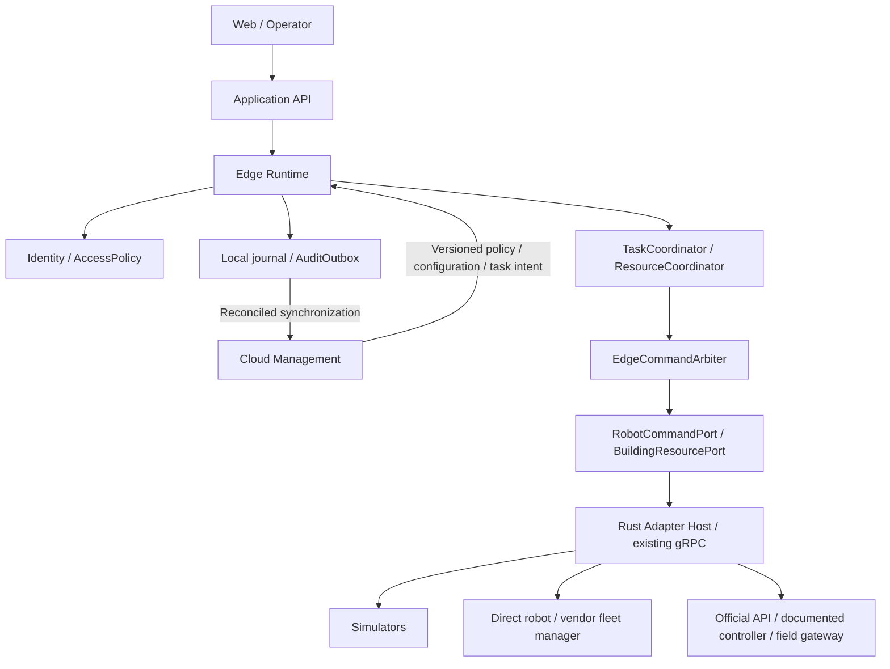

# Ürün kapsamı ve teknik yön

İnceleme tarihi: **2026-11-10**. Kod tabanı: `a976d449a29b670a9eef8d62cd020ec92cc58e11`.

Bu belge ürün kapsamı, hedef mimari, entegrasyon sınırları ve kabul kriterlerinin tek referansıdır. **Uygulanan özellik listesi değildir.** Bu görevde uygulama kodu, framework, protokol sözleşmesi veya bağımlılık değiştirilmemiştir. Repo ve üst dizinlerde `AGENTS.md` bulunmamıştır.

- [README](../README.md): mevcut projeyi çalıştırma ve doğrulama.
- [Mevcut kullanım senaryoları](use-cases.md): bugün çalışan simülasyonların durumları ve REST uçları. Bu belge onları tekrar tarif etmez.
- Aşağıdaki **öneriler** kabul edilmiş saha tasarımı veya cihaz uyumluluk taahhüdü sayılmaz. Donanım modeli, firmware ve tesis prosedürü bilinmeyen yerler açık bırakılmıştır.

## 1. Ürün ve ilk pazar kapsamı

Ürün, farklı robot ve bina/saha ekipmanlarını **kimlik, erişim, kaynak koordinasyonu ve görev akışı** üzerinden birleştiren yazılım ve gerektiğinde saha donanımıdır. Müşteri adayları robot üreticileri, robotik entegratörleri ve robot kullanan tesislerdir. İlk müşterinin hangisi olduğu henüz belirlenmemiştir; MVP için tek tesisli bir entegratör pilotu **çalışma varsayımıdır**.

Platform; izinli kapı/kat/bölge kullanımı, geçiş sırası, rezervasyon, bekleme noktaları, desteklenen hareket hedefleri, hata yönetimi ve operatör devrini yönetir. Robotun lokal navigasyonu, motor kontrolü ve çarpışma önlemesi robotta kalır. Platformun tesis koordinasyonu bu yerel işlevlerin yerine geçmez.

İlk ürün, sınırlı ve modellenmiş geçiş kaynaklarını koordine eder. Genel amaçlı sürekli uzay trafik planlayıcısı, her üreticiye hazır sürücü, bütün PLC'leri programlayan araç veya bina can güvenliği kontrolcüsü ilk MVP'nin kapsamı değildir. Yeni donanım geliştirmek her entegrasyonun önkoşulu değildir; belgelenmiş mevcut bir arayüz yeterliyse önce o kullanılır.

### Destek durumları

| Etiket | Anlam |
| --- | --- |
| `SIMULATED` | Açıkça etiketlenmiş sanal durum/olaylarla çalışır; saha kanıtı değildir |
| `IMPLEMENTED_UNVERIFIED` | Kod yolu mevcut; hedef donanımda uçtan uca doğrulanmamış |
| `PLANNED` | Yalnızca sözleşme/yol haritası önerisi; sürücü veya uyumluluk henüz yok |
| `FIELD_VERIFIED` | Belirli model, firmware, sürüm ve saha profili için kayıtlı kabul testi geçmiş |

**Şu an hiçbir entegrasyon `FIELD_VERIFIED` değildir.** Bir dokümanın veya şemanın okunması, robot/cihaz uyumluluk testi sayılmaz.

## 2. Koddan doğrulanan mevcut durum ve boşluklar

Mevcut yığın korunur: Spring Boot **3.5.7**, Kotlin **2.2.21**, JDK **21**, gRPC Java **1.76.0**; Rust/tonic **0.12**, prost **0.13**, Tokio; React **19.1.1**, TypeScript **5.9.2**, Vite **7.3.8**. Sürümler [backend](../backend/build.gradle.kts), [Rust manifesti](../robot-agent/Cargo.toml) ve [frontend manifestinde](../frontend/package.json) görülür. Rust manifestinin MSRV'si `1.85`, Docker derleyici imajı `1.93`'tür; bu görev bir yükseltme önermemektedir.

| Alan | Bugünkü kanıt | Hedefle arasındaki boşluk |
| --- | --- | --- |
| Süreçler | [Compose](../compose.yaml): frontend/nginx, Kotlin backend, Rust agent; Rust aynı süreçte dört gRPC service sunar | Ayrı edge/cloud rolü, cihaz yönetimi ve Greengrass paketi yok |
| Robot | [RobotService](../proto/robot.proto) yalnızca `GetStatus` ve `Stop`; pil/hız simülasyonda sabit | Hareket eden robot simülatörü, `NavigateTo`, `Wait`, `Resume`, `CancelTask`, görev/goal feedback ve capability profili yok |
| ROS 2 | [CLI adaptörü](../robot-agent/src/adapter.rs) sıfır `Twist` yayınlar; başarılı process exit `STOP_REQUESTED` olur | Abone kabulü, fiziksel duruş, navigation action, canlı telemetri veya saha doğrulaması yok |
| Kapı/asansör | [DoorSimulator](../robot-agent/src/door.rs), [ElevatorSimulator](../robot-agent/src/elevator.rs): manuel olaylarla bellekte ilerleyen singleton state machine'ler | Gerçek cihaz bağlantısı veya gerçek/simüle robot navigasyonu yok; `StartPassage` yalnızca durum değiştirir |
| Kaynak paylaşımı | Mutex ve `Busy` kontrolü eşzamanlı çağrıyı reddeder | Robot/task sahibine bağlı rezervasyon, kuyruk, öncelik, lease, bekleme noktası ve çoklu kaynak koordinasyonu yok |
| Alarm | [Ortak gate](../robot-agent/src/fire_alarm.rs) aktif demoları iptal eder; son sensör durumunu korur; temizleme devam ettirmez | Sabit demo politikasıdır; tesis prosedürü, harici alarm kaynağı ve fiziksel kurtarma doğrulaması yok |
| Kimlik/yetki | REST controller'ları doğrudan [RobotGateway](../backend/src/main/kotlin/dev/robotics/RobotGateway.kt) çağırır; gRPC `usePlaintext()` kullanır | Robot/user/service/gateway ayrımı, tenant/site, authentication, authorization, mTLS ve audit yok |
| Komut sahipliği | Robot stop mutex'i ve bina alarm gate'i süreç içi sıralama sağlar | `ControlAuthority`, planner owner, fencing ve manuel devir yok; başka ROS publisher'ı engellenmez |
| Mesaj güvenilirliği | `expectedState` aynı adımın hemen yinelenmesini reddeder; istemci deadline'ları var | Kalıcı `CommandId`, görev/olay kimliği, deduplication, sıra/boot bilgisi, outbox ve reconciliation yok |
| Telemetri | ROS'ta bilinmeyen pil/hız `null`; sanal kapı/kabin bilgisi phase'ten türetilir | Yanıt zamanı `observedAtUnixMs` yeni üretilir; gerçek sensör zamanı/freshness kanıtı değildir. Source time, quality ve stale/unknown modeli yok |
| Kalıcılık | Domain ve alarm durumu bellekte; restart başlangıca döndürür | Görev/rezervasyon kurtarma, alarmı kaynaktan yeniden doğrulama ve kalıcı audit yok |
| Haritalar | Asansör için `0..5` tamsayı katlar | Tesis/kat kimliği, harita sürümü, frame, birim ve kalibrasyon/dönüşüm eşlemesi yok |
| Diğer entegrasyonlar | VDA 5050, Open-RMF, MassRobotics, MQTT, Modbus, OPC UA, BACnet, Eaton ve AWS/Greengrass adaptörleri yok | Bunlar aşağıda `PLANNED`; iç REST/gRPC kullanımı dış cihaz protokol desteği değildir |

Loopback'e bağlanmak authentication değildir. Mevcut anonim yazma uçlarının gerçek adaptöre eriştiği bir dağıtım, hedef MVP'nin güvenlik sınırını karşılamaz.

### Doğrulama envanteri

Kodda **22 Rust** ve **23 Kotlin** test bulunur. Kotlin testleri loopback gRPC transport'u üzerinde test double service'leri kullanır; Rust agent'ı doğrudan çalıştırmaz. Dört REST smoke script'i robot, kapı, asansör ve alarm akışlarını dener. Bu dokümantasyon görevinde testler yeniden çalıştırılmamıştır.

Repo içinde kalıcı bir frontend test suite'i yoktur; `build` ve `typecheck` vardır. Önceki tarayıcı kontrolleri kaynakta otomatik regresyon suite'i sayılmaz. Yetkisiz erişim, açılmayan kapı, stale telemetri, kayıp çıkış teyidi, restart uzlaştırması ve kimlikli çoklu robot rezervasyonu kabul testleri henüz yoktur.

## 3. Küçük ekibe uygun hedef yapı

**Öneri:** mevcut üç deployable ile devam et; Kotlin tarafında modüler bir uygulama, Rust tarafında adaptör host'u ve mevcut simülatörler. Yeni mikroservis, broker veya Kubernetes önkoşulu koyma. Cloud ve edge önce **sorumluluk sınırlarıdır**; her modül ayrı servis değildir.

### Modül sınırları — önerilen, henüz uygulanmamış

| Mantıksal modül | Sorumluluk | Yasak bağımlılık/yan etki |
| --- | --- | --- |
| `identity` / `access` | Principal, tenant/site kapsamı, RBAC + resource/task koşulları, `AccessDecision` | Üretici SDK'sı veya doğrudan cihaz yazması |
| `tasks` | Geçiş adımları, bekleme, timeout, iptal, hata ve operatör devri | ROS mesajı/AWS tipi üzerinden domain kuralı yazmak |
| `coordination` | Resource ownership, kuyruk/öncelik, bekleme noktası, clearance | Süre dolmasını fiziksel boşluk kabul etmek |
| `commands` | Tek dispatcher, capability ve authority gate, komut ömrü/sonucu | İzin denetimini atlayan alternatif bir yazma yolu |
| `observations` / `maps` | Kaynak zamanı, sıra/kalite, frame/kat dönüşümleri | Yanıt zamanını yeni sensör ölçümü saymak |
| `emergency` | Sürümü onaylı `SiteEmergencyPolicy` ve olayların görev etkisi | Bina safety interlock'unu geçersiz kılmak |
| `audit` / `persistence` | Append-only karar/komut/olay kaydı, deduplication, checkpoint/outbox | Cloud yok diye hareket komutunu kayıtsız tekrar etmek |
| `adapters` | REST/gRPC sınırları, robot/cihaz/firmware/Greengrass çevirisi | İş politikasını vendor callback'lerine gömmek |

Kotlin'de örnek paket sınırları `dev.robotics.domain.*`, `application.*`, `adapters.*` olabilir. Domain değerleri ve port'lar Spring, protobuf, ROS mesajları veya AWS SDK sınıflarına bağımlı olmaz. Mevcut `RobotGateway` bu sınırların dış adaptöründe kalır.

Mevcut Rust state machine'leri kaldırılmaz: ilk dikey dilimde **simülasyon dünyası ve cihaz geri bildirimi** olarak kullanılır. Yeni Kotlin `TaskCoordinator` bunları çağırır; aynı geçiş için iki bağımsız iş akışı otoritesi kurulmaz. Kademeli sınırlandırma yapılır; bütün Rust domain kodunu yeniden yazmak veya taşımak bu planın önkoşulu değildir.

Edge journal için SQLite, küçük tek-edge pilotta **adaydır**; transaction ve restart testleriyle seçilmelidir. Cloud storage/queue ürünü henüz seçilmemiştir. Bu görev DB veya yeni dependency eklemez.

## 4. Domain ve adaptör sözleşmeleri

Aşağıdaki isimler hedef tasarımın İngilizce kavramlarıdır; mevcut proto alanları oldukları iddia edilmez.

| Model/port | Asgari içerik veya işlev |
| --- | --- |
| `ActorContext` | `principalId`, `principalType`, `tenantId`, `siteId`, credential/delegation bilgisi |
| `RobotProfile` / `AdapterCapabilities` | Model/firmware/protocol profile; desteklenen command, feedback, cancel/pause ve confirmation semantics |
| `Task` / `TaskStep` | `taskId`, `robotId`, amaç, izinli kaynaklar, adım durumu, deadlines, failure/compensation politikası |
| `Resource` / `Reservation` | Site/resource kimliği, holder task/robot, authority epoch, lease ve ayrı occupancy/clearance durumu |
| `ControlAuthority` | Robot/resource veya trafik alanı kapsamı, owner, `authorityEpoch`, geçerlilik, handoff durumu |
| `CommandEnvelope` | `commandId`, `taskId`, `stepId`, tenant/site/actor/robot/resource, payload hash, policy version, authority epoch, `issuedAt`, `expiresAt` |
| `ObservationEnvelope` | Kaynak/gateway kimliği, resource, `eventId`, boot/session, sequence, `sourceObservedAt`, `receivedAt`, quality, correlation bilgisi |
| `RobotCommandPort` | `NavigateTo`, `Wait`, `Resume`, `CancelTask`, durum/goal feedback; yalnızca capability ile izin verilen işlemler |
| `BuildingResourcePort` | Kapı/asansör/erişim/ışık için profilde tanımlı command ve bağımsız observation kanalı |
| `AuditPort` / `Clock` / `JournalPort` | Test edilebilir kalıcılık ve zaman sınırları; business kuralını altyapıdan ayırır |

Her adaptör, **yazabildiği komutları ve okuyabildiği durumları ayrı** bildirir. Örneğin `RequestOpen` desteği `ObserveDoorOpen` desteğini garanti etmez. `Capabilities` içinde confirmation yöntemi (`CORRELATED_EVENT`, onaylanmış `STATE_BASED` veya `OPERATOR_VERIFIED`), command/query idempotency, timeout, telemetry freshness ve bağlantı kaybı davranışı kayıtlı olur.

Röle/coil readback veya `OutputSet`, fiziksel `DoorOpen` kanıtı değildir. Gerekli sensör/pose kanıtı yoksa sonuç `UNVERIFIABLE`/unknown kalır ve otomatik geçiş izni verilmez. Bu ayrım firmware ve controller adapter contract testlerinde de aranır.

`UNSUPPORTED` bir sonuçtur; sahte `SUCCEEDED` üretilmez. Adaptör kapsam dışı komutu fiziksel dispatch yapmadan reddeder. Desteklenmeyen pause yerine hedefi silmek, cancel yerine sıfır hız yayınlamak veya MassRobotics telemetrisini görev kontrolü gibi kullanmak eşdeğer kabul edilmez.

### Komut kabulü, fiziksel sonuç ve clearance

Önerilen command yaşam döngüsü:

`CREATED → AUTHORIZED → DISPATCHED → ACCEPTED → EXECUTING → SUCCEEDED`

Yan durumlar: `REJECTED`, `FAILED`, `EXPIRED_BEFORE_DISPATCH`, `CANCEL_REQUESTED`, `CANCEL_CONFIRMED`, `OUTCOME_UNKNOWN`. Her adaptör bu aşamaların hangisini kanıtlayabildiğini belirtir. HTTP `200`, MQTT delivery, ROS publish veya action acceptance tek başına fiziksel başarı değildir. Gönderimden sonraki timeout sonucu genellikle `OUTCOME_UNKNOWN` olabilir; hareketin gerçekleşmediği varsayılmaz.

Workflow `CANCELLED`, robotun durduğu veya kaynağın boşaldığı anlamına gelmez. `GoalReached` de tek başına robotun bütün footprint'inin kapı/kabin dışına çıktığının kanıtı değildir. `ClearanceEvidencePolicy`, doğrulanmış robot konumu/footprint'i, cihaz sensörü veya yetkili operatör doğrulamasından hangi kanıtların gerektiğini saha profiline göre tanımlar. Bu kanıt yoksa kaynak boş ilan edilmez.

Cihaz command correlation taşımıyorsa var olmayan bir `commandId` echo'su uydurulmaz. Adaptörün onaylı taze durum okuma bariyeri veya manuel doğrulama profili kullanılır; belirsiz sonuç otomatik başarıya çevrilmez.

## 5. Karar ve komut yetkisi

**Temel kural:** politika kararı platformda; her **platform kaynaklı** robot/cihaz yazması tek `EdgeCommandArbiter` sınırından geçer. ROS 2 ve VDA adaptörleri hedef seçen bağımsız planlayıcılar değildir. Cloud, edge, RMF ve vendor fleet manager aynı robota ayrı ayrı hareket komutu göndermez. Yerel/native manual controller bu yazma yolunun dışında olabilir; o sırada otomatik yazarların kapandığı ve exclusive kontrol devri ayrıca doğrulanmalıdır.

`TrafficPlanningOwner` ortak trafik alanı/site kapsamında, `CommandOwner` robot kapsamında, `ResourceCommandOwner` kapı/asansör kapsamında açıkça atanır. Bir bölgeyi iki bağımsız planner aynı anda yönetemez.

| Deployment profili | Politika/görev | Trafik planlama | Hareket komutunun mantıksal sahibi / son yazma sınırı | Bina kaynakları |
| --- | --- | --- | --- | --- |
| `PLATFORM_MANAGED` — MVP önerisi | Platform | Platformun sınırlı topolojik kaynak/geçiş koordinasyonu | `PlatformDispatcher` / `EdgeCommandArbiter` | Platform rezervasyonu ve tek resource executor |
| `RMF_PLANNED` — sonraki aday | Platform erişim, görev ve resource grant'lerini korur | Seçilmiş ortak alan için RMF itinerary/schedule/negotiation | Yetkisi sınırlı `RmfFleetAdapter` / aynı arbiter; platform paralel `NavigateTo` göndermez | Resource owner ayrıca seçilir; RMF supervisor kullanılırsa platform ona paralel doğrudan cihaz komutu yazmaz |
| `VENDOR_FLEET_MANAGED` — koşullu aday | Platform izin ve görev niyetini yönetir | Belgelenmiş kapsamda vendor fleet manager | Yetkilendirilmiş `VendorFleetAdapter` / aynı arbiter | Platformun geçiş grant'lerini uygulatabilen belgelenmiş entegrasyon gerekir |
| `MANUAL` | Yetkili operatör ve tesis prosedürü | Belgelenmiş manual control mekanizması | Gateway üzerinden `ManualController` arbiter'ı kullanır; native/local kontrol için doğrulanmış exclusive handoff ve otomatik writer fencing gerekir | Kaynaklar fiziksel clearance doğrulanana kadar tutulur |

RMF profilinde platform, policy nedeniyle reddedilen talebi sessizce düşürmez; `BLOCKED`, replan veya operator-required sonucunu RMF'ye geri bildirir. Platformun erişim/rezervasyon kararını RMF tarafındaki sınırsız otomatik task acceptance'a bırakmak kabul edilmez. RMF supervisor otoritesi ile platform resource otoritesini bağlayacak bridge/session sözleşmesi ayrıca test edilir; bu repo henüz böyle bir bridge içermez.

Arbiter, **son gönderim anında** principal, policy version/validity, capability, görev/resource kapsamı, rezervasyon, alarm/prosedür, telemetry freshness ve `authorityEpoch` doğrular. Eski epoch'tan gecikmiş komut reddedilir. Adapter'lar arbiter dışında doğrudan kullanılmaz.

Vendor endpoint fencing token tanımıyorsa platform token'ının cihazı kendiliğinden koruduğu söylenemez. Tek aktif gateway/control session, izole credentials ve ulaşılabilir yazma yollarının sınırlandırılması gerekir. Başka bir ROS publisher veya vendor konsolu hâlâ bağımsız yazabiliyorsa garanti eksiktir; bu durum pilot kabulünü sınırlar.

### Manuel devir ve liderlik

Önerilen devir: `AUTONOMOUS → QUIESCING → HANDOFF_PENDING → MANUAL_ACTIVE → RECONCILING → AUTONOMOUS`.

Yeni admission kapanır; queued command'lar geçersizleşir, epoch artırılır. Desteklenen wait/cancel talebi gönderilir ve sonucu gözlenir; destek yoksa başarı varsayılmaz, operatöre devredilir. Robot/vendor tarafından kontrol sahipliği doğrulanmadan yeni owner'a otomatik hareket açılmaz. Manuel kullanım sonrası taze pose/mode/occupancy ve kaynak durumu uzlaştırılır. Fencing veya doğrulanabilir handoff sunmayan robotta otomatik devir `UNSUPPORTED` olabilir.

MVP'de bir site için tek aktif edge command owner önerilir. Cloud bağlantısı kesildi diye ikinci edge lider yapılmaz. Active-active failover bu aşamada yoktur; eski owner'ın yetkisizleştiği kanıtlanmadan yenisine hareket yetkisi verilmez.

## 6. Kaynak, harita ve görev koordinasyonu

### Rezervasyon ve doluluk ayrı modellerdir

`Reservation` kimin işlem yapmaya yetkili olduğunu; `OccupancyState = CLEAR | OCCUPIED | UNCONFIRMED` fiziksel alan hakkında ne bilindiğini ifade eder. Lease bitmesi, task iptali, robot bağlantı kaybı veya kullanıcı isteğinin timeout olması **alanı boşaltmaz**. Doluluk belirsizse yeni grant verilmez; kaynak `CLEARANCE_REQUIRED`/unavailable tutulur.

Release için ilişkilendirilmiş çıkış/clearance geri bildirimi veya politika kapsamında yetkili, audit'li manuel doğrulama gerekir. Aynı kaynağa iki robot talebinde transaction/compare-and-set ile tek holder seçilir; diğeri izinli bekleme noktasında kuyruğa alınır. Öncelik, starvation sınırı ve bekleme süreleri site policy'sidir; henüz sayısal varsayılan seçilmemiştir.

P2'de genel bir optimizasyon motoru yerine tek-edge deterministik resource scheduler yeterlidir. Kaynak alma sırası ve geçiş planı deadlock oluşturmayacak şekilde tanımlanır; kabine girişten önce çıkış alanı/bekleme olanağı doğrulanır. İlerideki kaynağı beklemek, mevcut fiziksel kaynağı kanıtsız serbest bırakma gerekçesi değildir.

### Harita ve kat eşlemesi

Önerilen `MapBinding`: `tenantId`, `siteId`, `levelId`, `facilityMapId/version`, `robotMapId/version`, `sourceFrame`, `targetFrame`, birim/eksen konvansiyonu, `Transform2D`, `transformVersion`, kalibrasyon kanıtı/toleransı ve geçerlilik.

Her `NavigateTo` hedefi `levelId`, `targetFrame`, `mapBindingVersion` ve `transformVersion` ile bağlanır; arbiter dispatch anında bu sürümleri de doğrular. Task sürerken harita/kalibrasyon değişirse eski queued goal gönderilmez; `BLOCKED`/replan veya operator-required olur. Zaten yürütülen hedef için eski koordinatı yeni dönüşümle sessizce yeniden göndermek yerine görev/robot durumu uzlaştırılır.

- İç canonical birimler metre ve radyan önerilir. Dönüşüm yönü açıkça `T_facility_from_robotMap` olarak kaydedilir; birim ölçeği, rotasyon ve öteleme ayrı doğrulanır. Planar olmayan dönüşüm desteklenmiyorsa hareket reddedilir.
- `odom` kalıcı tesis haritası gibi kullanılmaz; localization reset ve `bootId` değişiminde pose yeniden doğrulanır. ROS'un frame/birim kuralları için [REP-103](https://github.com/ros-infrastructure/rep/blob/master/rep-0103.rst) ve [REP-105](https://github.com/ros-infrastructure/rep/blob/master/rep-0105.rst) referanstır; robotun gerçek konvansiyonu ayrıca alınır.
- Platform `levelId`, üretici kat kodu, RMF level/map adı, VDA `mapId` ve MassRobotics `planarDatum` aynı kimlik sayılmaz. Mevcut `0..5` demo katları fiziksel kat numarası değildir; `0 = giriş` saha varsayımı olarak taşınmaz.
- Asansör floor/door feedback'inin doğru level ile eşleşmesi ve robotun doğru haritaya lokalize olması ayrı doğrulanır. Dönüşüm yoksa, eskimişse veya hata toleransı aşılmışsa hedef gönderilmez.
- İzinli bir hedef, yolun da izinli olduğunu kanıtlamaz. Lokal planner'ın yasak bölgeden geçmesini önleyecek no-go/route constraint veya doğrulanmış checkpoint sözleşmesi gerekir. Uygulatılamayan bölge kısıtı bulunan hareket kabul edilmez.

## 7. Kimlik, politika ve audit

| Principal | Kimliği ve güven sınırı |
| --- | --- |
| `UserPrincipal` | Operatör/yönetici; öneri OIDC tabanlı oturum ve görevine göre rol/politika |
| `RobotPrincipal` | Robot instance'ı; vendor serial ile otomatik eşitlenmez; tenant/site ve allowed capabilities bağlı |
| `ServicePrincipal` | API/coordinator/adapter servisi; bütün robotlar adına sınırsız yetki anlamına gelmez |
| `GatewayPrincipal` | Kaydedilmiş edge/field gateway; okuyabileceği sensörler ve yazabileceği cihazlar sınırlandırılır |

Önerilen kayıt akışı: envanterde pending cihaz → sınırlı bootstrap kanıtı → yetkili site/tenant eşlemesi → cihaza özgü operasyon kimliği → doğrulanmış `CapabilityProfile` → admission. Paylaşılan fabrika credential'ı kalıcı işletim kimliği yapılmaz. Donanım elveriyorsa özel anahtar koruması/TPM değerlendirilir; her adayda var sayılmaz.

Desteklenen bağlantılarda sertifika/mTLS; ayrı trust store, süre bitmeden rotation, kontrollü kısa overlap, eski sertifika iptali ve cache etkisi test edilir. TLS veya client certificate sunmayan dijital I/O/legacy OT cihazına mTLS varmış gibi davranılmaz: güven sınırı gateway'e taşınır, ağ/erişim sınırlandırılır, kalan risk saha profiline yazılır. Taşıma kimliği fiziksel sensörün doğruluk kanıtı değildir.

RBAC işlem sınıfını, resource/task/site koşulları somut erişimi sınırlar. Örnek kural: `robot-sim-01`, yalnızca `tenant-a/site-a` içinde, `DeliveryTask` amacıyla `door-01` ve `level-1/level-2` kaynaklarına erişebilir. Bunlar **test fixture kimlikleridir**. Client'ın body'ye başka `siteId` yazması scope'u değiştirmez; authenticated context, envanter ve resource ownership birlikte doğrulanır.

`AccessDecision` adapter dispatch'ten önce ve son yazma sınırında uygulanır. Geçiş grant'i kısa ömürlü ve robot/task/resource/authority epoch'a bağlıdır; bir başka görevde tekrar kullanılamaz. Kullanıcı adına robot çalıştırılırsa hem kullanıcı delegasyonu hem robotun resource izni gerekir. Kontrolcünün kendi access interlock'u da geçilmek zorundadır.

Tenant/site izolasyonu sorgu, command, observation, cache, certificate/config scope ve audit storage düzeyinde uygulanır. İnsan rolü, cihaz kimliği ve gateway servis yetkisi birbirine çevrilmez. MQTT kullanılırsa topic ACL'leri de tenant/site/device kapsamını korur; bunlar domain authorization yerine geçmez.

**Eski yol bypass'ı:** yeni authenticated endpoint eklemek yeterli değildir. Mevcut `/api/robot/stop`, door/elevator yazma uçları, gRPC adapter kanalı ve simülasyon olay uçları da korunmalı veya yalnızca kapalı development profile'da kalmalıdır. Gerçek adaptör anonim eski controller'dan çağrılamaz.

Audit önerisi: append-only `AccessDenied`, `AccessGranted`, command dispatch/ack/outcome, observation, reservation, authority handoff, alarm/procedure ve operator override kayıtları. Her kayıt actor, tenant/site, task/command/resource, policy/config/authority sürümü, zaman ve correlation içerir; credential/secret içermez. Yeni fiziksel dispatch öncesi yerel dayanıklı niyet/audit kaydı yazılır. Cloud'a gönderim ayrıca `AuditOutbox` ile yapılır. Yerel kayıt alanı dolarsa yeni normal görev/komut admission'ı kapanır; mevcut görevin davranışı site prosedürü ve önceden ayrılmış kayıt bütçesiyle ele alınır, bütün robotları evrensel biçimde durdurma varsayılmaz.

## 8. Hata, mesaj ömrü ve olağan dışı olaylar

| Durum | Hedef davranış |
| --- | --- |
| Aynı `commandId`, aynı payload | Kalıcı deduplication ile kayıtlı sonuç/pending outcome döner; platform ikinci dispatch yapmaz. Cihazın fiziksel duplicate suppression garantisi ayrıca profile bağlıdır |
| Aynı `commandId`, farklı payload | Conflict/security olayı; dispatch yok |
| Eski/gecikmiş/sırası değişmiş feedback | `bootId`, source sequence, task/step ve correlation kontrol edilir; eski event ilerletmez |
| Eski `DoorOpen` veya kayıp telemetri | `STALE`/`UNKNOWN`; geçiş izni üretilmez. Her GET'te yeni server saati vermek freshness sağlamaz |
| Gönderimden önce command expiry | `EXPIRED_BEFORE_DISPATCH`; adapter invocation yok |
| Dispatch sonrası ACK kaybı/deadline | `OUTCOME_UNKNOWN`; sorgula/uzlaştır veya operatöre devret; kör retry yok |
| Cancel kabulü | Terminal iptal veya fiziksel duruş olarak sunulmaz; ayrı feedback beklenir |
| Çıkış teyidi kaybı/lease expiry | Kaynak `UNCONFIRMED`/clearance-required kalır; başka robota verilmez |
| Cihaz arızası/manual override | Kaynak admission'ı kapanır, authority ve task etkisi policy'ye göre ele alınır |
| Restart | Journal yüklenir; robot/control mode, açık komutlar, alarm ve doluluk taze kanıtla uzlaştırılmadan hareket açılmaz |

Adaptörler zaman kaynağını ve confirmation kalitesini bildirir. Kaynak sequence sunmuyorsa gateway'in yerel sırası, cihazın geçmiş mesajları ayırt ettiği anlamına gelmez; kabiliyet sınırı kaydedilir. Saat güvenilir değilse yeni motion admission için policy'nin bounded davranışı veya ret uygulanır. TTL ve toleranslar gerçek model/site gereksinimlerinden seçilir; bu belge donanım timeout'u uydurmaz.

Fiziksel retry yalnızca command henüz gönderilmediyse veya seçilen cihaz/profil aynı kimlikle duplicate suppression ve sonuç sorgusunu doğruluyorsa düşünülür. MQTT QoS, gRPC retry veya `expectedState` fiziksel exactly-once garantisi değildir. Fiziksel hareket komutları retained/durable kuyruktan reconnect sonrasında topluca yeniden oynatılmaz; son gönderim gate'i expiry ve authority'yi tekrar kontrol eder. Audit/event gönderimlerinin kimlikli tekrar denenmesi bununla aynı şey değildir.

### Yangın ve tesis prosedürü

Hedefte `SiteEmergencyPolicy`, güvenilir alarm kaynağı, zone etkisi, onaylı prosedür/sürüm, izinli exit/holding davranışı ve operator escalation tanımlar. Bütün kapıları açmak, bütün robotları oldukları yerde durdurmak veya her asansörü aynı kata göndermek evrensel kural değildir. Bina can güvenliği interlock'u ve yetkili kontrolcü geçersiz kılınmaz.

Politika/prosedür eksik veya alarm güven durumu belirsizse etkilenen alana yeni normal geçiş kabul edilmez ve operatöre devredilir. Devam eden robotun çıkışı/beklemesi yalnızca site prosedürü ve doğrulanmış capability ile seçilir. Robotun `Wait` desteklemediği yerde başarılı bekleme uydurulmaz. Çıkış hareketinin de güvenli olduğu veya her yerde durmanın doğru olduğu varsayılmaz.

Bugünkü sabit `CANCELLED` demo davranışı bir `SiteEmergencyPolicy` uygulaması değildir; regresyon simülasyonu olarak korunur. `ResetCancelledSimulations` sanal robot/doluluk verisini değiştirir ve **üretimde fiziksel recovery endpoint'i olarak kullanılamaz**. Hedefte alarm clear ile fiziksel clearance ayrı yetkili kanıtlar gerektirir.

## 9. Edge ve cloud

| Edge Runtime | Cloud Management |
| --- | --- |
| Yerel adapter'lar, task/step yürütme, policy evaluation | Tenant/site/robot/resource envanteri |
| Resource/traffic grant'leri, son command gate ve authority | Onaylı config/policy ve harita sürümleri |
| Taze observation/harita doğrulaması, site emergency policy | Yazılım/component dağıtımı ve cihaz yaşam döngüsü |
| Dayanıklı command/task journal, deduplication, yerel audit outbox | Fleet-wide izleme, audit toplama ve yönetim arayüzleri |
| Bağlantı ve restart sonrası yerel reconciliation | Edge capability/health/deployment sonucunu izleme |

Cloud bir hareket command writer'ı olmaz. Cloud'dan gelen görev isteği, edge'in yeniden yetkilendirdiği süreli bir `TaskIntent` olur. Cloud storage veya bağlantının varlığı fiziksel döngünün her adımı için şart yapılmaz.

### İnternet kesintisi kararı

Önerilen `PolicySnapshot`: tenant/site, sürüm, `issuedAt`, `validUntil`, signature/integrity, credential/revocation snapshot sürümü ve izinli offline işlemler. Sayısal TTL'ler site kararıdır; henüz seçilmemiştir.

| İşlem | Offline karar |
| --- | --- |
| Yerel durum izleme ve audit yazma | Yerel kaynaklar çalışıyorsa devam; kalite/kesinti açık gösterilir |
| Yeni yerel geçiş | Kimlik, policy/grant, authority ve harita geçerli; gerekli feedback taze; site offline policy izinliyse kabul |
| Mevcut geçiş | Geçerli checkpoint ve site prosedürüyle sürdür/beklet/operatöre devret; ağ koptu diye fiziksel duruş varsayma |
| Yeni enrollment/yetki genişletme/uzaktan owner takeover | Online doğrulama olmadan reddet |
| Süresi dolmuş policy veya revocation bilgisi kabul edilen yaşı aşmış | Yeni normal motion/admission reddedilir; mevcut görev için tanımlı prosedür uygulanır |
| Cloud audit/monitoring aktarımı | Kimlikli outbox'ta tutulur; kapasite/disk politikası uygulanır |
| Reconnect'te bekleyen hareket | Expired komut drop/terminal kayıt; kendiliğinden replay yok |

Offline edge, cloud'daki yeni credential iptalini anında bilemez. Offline izin, revocation snapshot yaşı ve grant TTL'siyle sınırlanır; sıfır gecikmeli iptal garantisi verilmez. Reconnect'te önce saat/kimlik/policy/authority ve fiziksel durum uzlaştırılır, sonra yeni task admission açılır. Eski cloud isteğinin zaman aşımı bitti diye yeni bir görev gibi tekrar yaratılması da replay sayılır.

## 10. Entegrasyon matrisi ve doğrulanmış sürüm sınırları

Bu bölümdeki kaynaklar **2026-11-10 tarihinde incelenmiş referanslardır**. Seçilmiş robot/cihaz olmadığı için saha compatibility profile'ı onaylanmış değildir. Bir adaptör sürümü, schema revision'ı ve cihaz firmware'i birlikte pinlenir; `latest` etiketiyle uyumluluk taahhüt edilmez.

### Robot ve koordinasyon entegrasyonları

| Teknoloji | Amaç ve doğrulanmış sınır | Gerekli bilgi | Mevcut destek |
| --- | --- | --- | --- |
| ROS 2 | Robotun topic/service/action arayüzleri; evrensel `NavigateTo`/pause endpoint'i yok | Distro, OS/RMW, namespace, tipler, QoS, action feedback/cancel ve model capability'leri | Zero-Twist CLI yolu `IMPLEMENTED_UNVERIFIED`; diğerleri `PLANNED` |
| VDA 5050 | MQTT/JSON order/action/state/factsheet; fleet control ile robot arası sözleşme | Sürüm, model/firmware/factsheet, broker/security, action scopes, map ve offline davranış | `PLANNED` |
| Open-RMF | Fleet integration, itinerary/schedule/negotiation ve bina koordinasyonu | ROS distro + paket manifesti, full-control/traffic-light kapsamı, authority ve resource supervisor seçimi | `PLANNED` |
| MassRobotics AMR Interoperability | Doğrulanan 1.0 identity/status verisi; görev kontrolü olduğu doğrulanmadı | Schema/profile, identity, `planarDatum`, birim/frame ve transport/security | Read-only adapter `PLANNED`; görev komutları bu sözleşmeden çıkarılmaz |
| Vendor robot/fleet API | Direct robot veya fleet manager üzerinden destekli görev/konum/control mode | Resmî API/model/firmware/lisans, task lifecycle, yetki devri ve route constraints | `PLANNED`; üretici bilinmiyor |

**ROS 2:** README'deki Jazzy örneği korunur; resmî destek tablosu Jazzy için Mayıs 2029 gösterir. Bu, robot uyumluluğu testi değildir ve distro yükseltmesini gerektirmez. Topic publish fiziksel başarı değildir; service kısa request/response, action uzun görev/feedback/result/cancel sözleşmesi sağlar. `CancelGoal` kabulü terminal cancellation değildir. QoS eşleşmesi ve service durability davranışı ayrıca doğrulanır. Kaynaklar: [ROS releases](https://github.com/ros2/ros2_documentation/blob/rolling/source/Releases.rst), [Topics](https://github.com/ros2/ros2_documentation/blob/jazzy/source/Concepts/Basic/About-Topics.rst), [Services](https://github.com/ros2/ros2_documentation/blob/jazzy/source/Concepts/Basic/About-Services.rst), [Actions](https://github.com/ros2/ros2_documentation/blob/jazzy/source/Concepts/Basic/About-Actions.rst), [CancelGoal](https://github.com/ros2/rcl_interfaces/blob/jazzy/action_msgs/srv/CancelGoal.srv), [QoS](https://github.com/ros2/ros2_documentation/blob/jazzy/source/Concepts/Intermediate/About-Quality-of-Service-Settings.rst).

**VDA 5050:** güncel yayımlanmış referans **3.0.0** (Mart 2026); resmî `3.0.0` tag commit'i `e9ba560b0e2d3f66526550ad5d61b8a2ad936172`. `2.1.0` ayrı eski profil adayıdır; major sürümler arası otomatik uyumluluk varsayılmaz. `NavigateTo`, uygun node/edge order modeline çevrilir; genel bir `goto` action uydurulmaz. Factsheet ve seçilmiş sürümdeki `cancelOrder`, `startPause`, `stopPause`/action kısıtları sahada doğrulanır. `MANUAL` mode'da fleet order/instantAction gönderilmez; telemetri takibi bununla karıştırılmaz. Önemli offline sınır: broker bağlantısı kopunca robot mevcut order bilgisini koruyup son released node'a kadar ilerleyebilir; alan boş veya robot durmuş sayılamaz. İptal eyleminin tamamlanması da ayrıca gözlenir. Kaynaklar: [VDA yayını](https://www.vda.de/en/news/publications/publication/vda-5050), [3.0.0 release](https://github.com/VDA5050/VDA5050/releases/tag/3.0.0), [2.1.0 release](https://github.com/VDA5050/VDA5050/releases/tag/2.1.0), [sabit spec](https://github.com/VDA5050/VDA5050/blob/3.0.0/VDA5050_EN.md). [Resmî repo uyarısı](https://github.com/VDA5050/VDA5050/blob/main/README.md) gereği GitHub metni/schema ile yayımlanan VDA PDF'i çelişirse PDF esas alınır.

**Open-RMF:** tek bir wire-protocol sürümü değildir. Doğrulanan test tabanı adayı `ROS 2 Jazzy` + [sabit `rmf.repos` manifesti](https://github.com/open-rmf/rmf/blob/6aeae8db7256ef10fae785adae2e430f90f3f27e/rmf.repos): `rmf_ros2=2.7.2`, `rmf_internal_msgs=3.3.1`, `rmf_traffic=3.3.3`. Bu manifest üretim seçimi veya global latest iddiası değildir. Fleet callback'lerini gerçek robot API'sine bağlama ve canlı pose/path güncellemesi integrasyonun işidir. [Fleet integration](https://osrf.github.io/ros2multirobotbook/integration_fleets.html), [EasyFullControl 2.7.2](https://github.com/open-rmf/rmf_ros2/blob/2.7.2/rmf_fleet_adapter/include/rmf_fleet_adapter/agv/EasyFullControl.hpp).

**Fiziksel traffic light ≠ RMF Traffic Light.** Fiziksel kırmızı/yeşil lamba, kendi kontrolcüsü ve feedback'i olan saha kaynağıdır. RMF `EasyTrafficLight`, robot route/checkpoint ve pause/wait/resume koordinasyonu içindir; Full Control veya fiziksel lamba sürücüsüyle eşdeğer değildir. Seçilmiş [2.7.2 API kaynağı](https://github.com/open-rmf/rmf_ros2/blob/2.7.2/rmf_fleet_adapter/include/rmf_fleet_adapter/agv/EasyTrafficLight.hpp) referans alınır. Supervisor'ı atlayıp doğrudan ROS door/lift node'una gönderilen istekler supervisor tarafından geri alınabilir; bu nedenle bu node'lara paralel writer kurulmaz. Bu, fiziksel kontrolcüdeki her harici komutun geri alınabildiği iddiası değildir. [Door integration](https://osrf.github.io/ros2multirobotbook/integration_doors.html), [Lift integration](https://osrf.github.io/ros2multirobotbook/integration_lifts.html).

**MassRobotics:** resmî public release listesinde doğrulanan sürüm **1.0**, tag commit'i `7161a0d2b26606941f5a012cd03c7f113beb7a22`. Daha yeni yayımlanmış görev kontrolü sürümü doğrulanmadı. `identityReport`/`statusReport`, konum/hız/boyut/pil/state/path gibi birlikte çalışabilirlik verisidir. Belgelerde anılan gelecekteki 2.0 mission API çalışması yayımlanmış destek sayılamaz. `NavigateTo`, `Wait`, `Resume`, `CancelTask` ayrı command adapter gerektirir. Örnek sender/receiver WebSocket kullanır; örnek `ws://` üretim güvenlik profili değildir. Kaynaklar: [1.0 release](https://github.com/MassRobotics-AMR/AMR_Interop_Standard/releases/tag/1.0), [sabit schema](https://github.com/MassRobotics-AMR/AMR_Interop_Standard/blob/1.0/AMR_Interop_Standard.json), [resmî kapsam açıklaması](https://www.massrobotics.org/what-is-the-massrobotics-amr-interoperability-standard/), [sender](https://github.com/MassRobotics-AMR/AMR_Interop_Standard/blob/1.0/MassRobotics-AMR-Sender/README).

### Bina/saha ekipmanları ve üç bağlantı yolu

| Cihaz/teknoloji | Amaç | Doküman/karar için gereken bilgi | Mevcut destek |
| --- | --- | --- | --- |
| Resmî üretici API'si | Üreticinin desteklediği command ve feedback | Tam model/firmware, API revision/lisans, auth, command ACK/result, hata ve interlock davranışı | `PLANNED`; API/endpoint bilinmiyor |
| Mevcut kontrolcü | Belgelenmiş mevcut arayüz üzerinden komut ve durum | Model, wiring/topoloji, protocol manual, erişim izni, read/write listesi ve feedback kanıtı | `PLANNED` |
| Özel saha donanımı + firmware + gateway | Uygun arayüz yokken onaylı sinyal sınırını kurmak | Elektriksel I/O tipi/seviyesi, izolasyon, interlock, watchdog/fail state, feedback kaynağı, firmware/update ve saha test planı | `PLANNED`; kart/firmware tasarımı yok |
| Asansör | Çağırma, seçili kat, door/floor/cabin durumu | OEM/servis sağlayıcı arayüzü, kat kodları, erişim/yangın işletimi, session authority | Yalnız `SIMULATED` |
| Otomatik kapı/erişim sistemi | Açılma isteği, access decision ve açık/kapalı/engel feedback | Kapı + kontrolcü + access controller modeli, belgelenmiş izinli sinyaller, sensörler | Yalnız `SIMULATED` |
| Fiziksel trafik ışığı | Ortak geçiş için gösterge/control state | Lamba değil kontrolcünün modeli, renk/izin anlamı, feedback ve bağlantı kaybı davranışı | `PLANNED` |
| Yangın alarmı olayları | Güvenilir olayın site prosedürüne göre görevlere etkisi | Panel/model, olay arayüzü, zone mapping, source trust ve onaylı prosedür | Sabit demo politikası `SIMULATED`; gerçek panel yok |
| Eaton adayı | Belgelenmiş rolüne göre PLC/akıllı röle/I/O veya başka kontrolcü | **Tam model/part number ve firmware olmadan cihaz tipi/protokol seçilmez**; lisans ve wiring manual gerekir | `PLANNED / ModelUnknown` |
| REST / MQTT | İlgili cihaz belgeliyorsa command/observation transport'u | API veya topic/schema/version, auth/TLS/ACL, QoS/retain/session/correlation | İç REST mevcut; harici cihaz REST/MQTT adaptörü yok |
| Modbus / OPC UA / BACnet | Belgelenmiş register/object/service üzerinden entegrasyon | Model-specific address/object map, tip/birim, izinli write, handshake, polling/event ve güvenlik özellikleri | `PLANNED`; register/object adresi seçilmedi |
| Dijital I/O | Onaylı giriş/çıkış sinyallerini okuyup sürmek | Dry contact/gerilim tipi, izolasyon/polarite, pulse/level, debounce, feedback ve fail state | `PLANNED`; pin/elektriksel davranış bilinmiyor |

Bir cihazın açma çıkışını sürmek, açık sensörü okuyabildiğimiz anlamına gelmez. Okuma ve yazma farklı arayüzlerden yapılacaksa observation fusion ve sole-writer sınırı açıkça tanımlanır. Belgelenmeyen register, endpoint, topic, röle polaritesi veya alarm reset davranışı eklenmez. Bilinmeyen yerler yalnızca etiketli simulator ve `CapabilityProfile`/adapter port'larıyla temsil edilir.

## 11. AWS IoT Greengrass V2 dağıtım adaptörü

**Durum: `PLANNED`.** İş mantığı Greengrass dışında aynı Kotlin/Rust executable'larıyla ve local test doubles/simulators ile çalışmalıdır. Greengrass IPC, AWS credentials ve deployment event'leri dış adaptördür; domain'e bağımlılık oluşturmaz.

Önerilen component sınırları mevcut süreçlerle eşleşir: `com.robotics.EdgeRuntime`, `com.robotics.AdapterHost`; field gateway firmware yönetimi yalnızca hedef donanım belirlendiğinde eklenir. Component adları öneridir. Recipe; platform manifests, artifacts, lifecycle ve dependency sürümlerini tanımlar. Resmî format `RecipeFormatVersion: "2020-01-25"` ve component SemVer kullanır. Artifact hash/provenance, OS/CPU/JDK/native bağımlılıkları ve component BOM birlikte pinlenir. [Recipe reference](https://docs.aws.amazon.com/greengrass/v2/developerguide/component-recipe-reference.html).

Hedef Nucleus sürümü henüz seçilmedi. Okunan resmî changelog `2.18.4` içerirken `clientdevices.Auth 2.5.5` belgesi Nucleus `>=2.6.0 <2.17.0` aralığı bildiriyor; dolayısıyla bağımsız olarak en yüksek sürümleri birleştirmek uyumluluk değildir. Client-device auth gerekip gerekmediği de bilinmiyor. [Nucleus](https://docs.aws.amazon.com/greengrass/v2/developerguide/greengrass-nucleus-component.html), [Client device auth](https://docs.aws.amazon.com/greengrass/v2/developerguide/client-device-auth-component.html).

| Dağıtım konusu | Ürün planı ve AWS sınırı |
| --- | --- |
| Enrollment/kimlik | Core gateway ve MQTT client device ayrı rollerdir; her robot/PLC otomatik client device olmaz. Claim/bootstrap sınırlı, operasyon sertifikası cihaza özgü; pre-provisioning yetkisi doğrulanır |
| Config | Versioned config + uygulama schema/policy doğrulaması; Greengrass `reset` ardından `merge` uygular. Secret düz metin recipe/config'e gömülmez |
| Credentials | `TokenExchangeService` AWS servis erişimi sağlar; robotun kapı erişim yetkisi değildir. `SecretManager` dış adaptörde kullanılabilir |
| Sertifika ömrü | Provision, rotate, overlap, revoke ve offline cache test edilir. Yerel broker sertifikası otomatik rotasyonu, core'un cloud operasyon sertifikasının otomatik yenilendiği anlamına gelmez |
| Deployment | Things/thing groups, pinli component seti, config değişimi, sağlık/rollback ve cihaz bazlı sonuç takibi. Offline cihaz yeni deployment'ı reconnect'te alabilir; bu bir motion replay mekanizması değildir |
| Aktif görev sırasında update | Admission/drain, durable checkpoint, authority ve occupancy korunması; restart sonrası reconciliation. `DeferComponentUpdate` yardımcıdır, fiziksel interlock değildir; timeout'ta update ilerleyebilir |

Kaynaklar: [Device auth](https://docs.aws.amazon.com/greengrass/v2/developerguide/device-auth.html), [Fleet provisioning](https://docs.aws.amazon.com/greengrass/v2/developerguide/fleet-provisioning.html), [Configuration updates](https://docs.aws.amazon.com/greengrass/v2/developerguide/update-component-configurations.html), [Token exchange](https://docs.aws.amazon.com/greengrass/v2/developerguide/token-exchange-service-component.html), [Secret manager](https://docs.aws.amazon.com/greengrass/v2/developerguide/secret-manager-component.html), [X.509](https://docs.aws.amazon.com/iot/latest/developerguide/x509-client-certs.html), [Deployments](https://docs.aws.amazon.com/greengrass/v2/developerguide/manage-deployments.html), [Lifecycle IPC](https://docs.aws.amazon.com/greengrass/v2/developerguide/ipc-component-lifecycle.html).

AWS'nin client offline authentication cache'i ürün policy/grant TTL'sinden ayrıdır. Cloud'daki revocation offline edge'e anında ulaşmaz; AWS cache ayarı uygulama seviyesinde sınırsız offline yetki vermez. [Offline authentication](https://docs.aws.amazon.com/greengrass/v2/developerguide/offline-authentication.html).

## 12. Aşamalar ve somut kabul kriterleri

Her aşama bir önceki güven sınırını korur. P0 dışındakiler **plan** durumundadır. Simülasyon testi ile model/firmware/site bazlı saha doğrulaması ayrı raporlanır.

| Aşama | Kapsam | Tamamlanma kapısı |
| --- | --- | --- |
| `P0 — Baseline` | Mevcut kodu/demoları koru; kapsam ve sözleşmeleri kaydet | Uygulama değişmeden destek durumları, boşluklar ve açık kararlar bu belgede ayrılmış |
| `P1 — AuthorizedDoorPassage MVP` | Bir simüle robot + bir simüle kapı; kimlik → yetki → command → fresh feedback → grant → robot exit → audit | Aşağıdaki P1 kabul testleri fiziksel ekipman olmadan otomatik geçer; mevcut demolar regresyon olarak kalır |
| `P2 — TwoRobotMultiFloor` | İki robot, iki level, bir asansör ve bir kapı; kimlikli rezervasyon/queue/holding points | Aynı kaynağa çifte grant yok; kat/kapı/kabin/exit doğrulaması ve kayıp teyitte kaynak tutma testleri geçer |
| `P3 — OneVerifiedAdapter Pilot` | Seçilmiş tek robot/fleet ve tek bina cihazı; üç bağlantı yolundan uygun olanı; gerekiyorsa firmware/gateway | Model/firmware/protocol/route constraints/safety procedure ve security profili doğrulanmış; ACK/result ayrımı ve saha failure testleri kayıtlı |
| `P4 — ManagedEdge` | Cloud inventory/config/audit, kayıt/sertifika ömrü, Greengrass component BOM/deployment/OTA | Aynı domain yerelde ve component olarak aynı contract testlerini geçer; internet kesintisi, revocation TTL, update/restart/reconciliation ve replay=0 testleri geçer |
| `P5 — AdditionalProfiles` | İhtiyaca göre VDA/ROS/RMF/MassRobotics profilleri, fiziksel traffic light ve daha fazla vendor | Her yeni profil için versioned capabilities, authority ve conformance kanıtı; desteklenmeyen özellikler açıkça `UNSUPPORTED` |

Güvenlik ilk kez P4'te eklenmez: P1'de identity/policy/audit, P2'de authority/fencing/reservation, **P3 saha öncesinde** gerçek enrollment, desteklenen bağlantılarda mTLS, rotation/revocation ve site izolasyonu gereklidir. Greengrass'ın otomatik merkezi rollout'u ayrı aşamadır.

### P1 kabul kriterleri

1. Signed test identity ile bir `RobotPrincipal`, `tenant-a/site-a` ve `door-01` için izinli görev oluşturur. Eksik/geçersiz kimlik reddedilir; yanlış robot/site/resource/task yetkisi olan istekte **adapter dispatch count = 0** ve red audit'i vardır. Test issuer production identity provider olarak sunulmaz.
2. İzinli komut tek `CommandId`/task/step ile journal'a yazılır ve kapı simulator adapter'ına tam bir kez gönderilir. Aynı kimlik/farklı payload reddedilir; duplicate aynı istek yeni adapter çağrısı üretmez.
3. Command ACK tek başına geçiş izni vermez. Taze, doğru resource/boot/task/step'e ait `DoorOpen` kanıtı gerekir. Eski veya başka geçişe ait olay ilerletmez.
4. Simüle robot adapter'ı gerçekten görev hedefi/ilerleme/exit feedback'i üretir. UI'de durum düğmesine basmak robot hareketi gibi raporlanmaz. `ClearanceEvidencePolicy` ile çıkış doğrulanınca task tamamlanır ve grant/resource bırakılır.
5. Kapı açılmazsa kontrollü test saati deadline'ı geçirir: robot passage başlatılmaz, grant verilmez; bilinen sonuca göre `FAILED` veya `OUTCOME_UNKNOWN`/operator-required ve audit oluşur. Fiziksel open komutu kör retry edilmez.
6. Alarm, bağlantı kaybı veya eski/kayıp telemetry görev durumunu değiştirir. Test `DemoSiteProcedure` açıkça simülasyon fixture'ıdır. Kayıp exit teyidi ve lease expiry kaynağı boşaltmaz.
7. Process dispatch'ten hemen sonra kapanırsa restart, kayıtlı niyeti okuyup fiziksel/sanal durumu uzlaştırır; aynı etkiyi otomatik tekrar üretmez. Geçmiş `DoorOpen` event'iyle görev tamamlanmaz.
8. Legacy REST/gRPC/simulation yolları authz sınırını bypass edemez. Mevcut development demoları gerçek adaptör profile'ıyla anonim erişime açılamaz.

### P2 kabul kriterleri

İki robot için rota: izinli bekleme noktası → kaynak talebi → asansör çağrısı → doğru kat + açık kapı kanıtı → robotun kabine girişi → hedef kat komutu → doğru hedef kat + açık kapı kanıtı → çıkış → kaynak release → kapı geçişi.

- Aynı anda iki talep transaction altında tek holder üretir; diğeri izinli wait point'te bekler. Queue priority/aging davranışı deterministik test edilir.
- Yanlış kat, kapı kapalı, kalibrasyonu eksik map veya başka robota ait feedback giriş/çıkış adımını ilerletmez. Robotun route constraints'i uygulanamıyorsa görev reddedilir.
- Görev sırasında map/transform sürümü değişirse eski sürüme bağlı queued goal için adapter dispatch count sıfırdır; yeniden planlama/uzlaştırma gerekir.
- Kabin/çıkış teyidi kaybolursa asansör/egress kaynağı bloke kalır; lease timeout ikinci robota grant vermez. Operatörün verified clearance işlemi actor/evidence ile audit edilir.
- Alarm veya iletişim kaybında site procedure uygulanır; kaynağın serbestliği ve robotun durduğu uydurulmaz. Alarm clear otomatik resume oluşturmaz.
- Manual takeover ve eski `authorityEpoch` taşıyan gecikmiş komut denenir; eski yazarın adapter invocation sayısı sıfırdır.
- Restart veya WAN reconnect'te önce reconciliation yapılır. Expired `NavigateTo`/order intent için replay count sıfırdır; eski alarm olayı/correlation yeni görevi yanlış tamamlamaz.

### P3/P4 kabul ölçüleri

P3'te eşiğin hangi sensör/pose ile boş sayıldığı, cihaz timeout'ları, kapı/kat kodları ve route toleransları üretici dokümanı ve saha ölçümüyle belirlenir; bu belge sayı uydurmaz. Yetkisiz yazma, bağlantı kaybı, cihaz fault'u ve manuel müdahale ilgili gerçek profile'da denenmeden `FIELD_VERIFIED` etiketi verilmez.

P4'te geçerli policy ile izinli offline local iş, expired policy ile yeni görev reddi, offline revocation gecikmesi, outbox kapasitesi, reconnect deduplication, sertifika yenileme/iptali ve aktif görev sırasında component restart test edilir. Yeni deployment, dolu/belirsiz kaynağı boş göstermemeli; süresi geçmiş hareket göndermemelidir. TLS'siz legacy bağlantının mTLS testi geçmiş gibi raporlanması kabul edilmez.

## 13. İlk küçük geliştirme görevi

**Önerilen backlog maddesi: `P1.1 — AuthorizedDoorRequest`. Bu görevde uygulanmadı.**

Mevcut simülasyonu koruyarak Kotlin'de `ActorContext`, scope'lu ID'ler, `AccessPolicy`, `CommandEnvelope`, `DoorCommandPort` ve `AuditPort` sınırını tek bir authenticated door request akışına ekle. Simulator port'u mevcut Rust kapı davranışına bağlansın. Domain'e vendor/ROS/AWS sınıfı taşınmasın; yığın yeniden yazılmasın ve gerçek cihaz adaptörü eklenmesin. Gereken kimlik doğrulama ve kalıcılık bağımlılıkları bu küçük görevde ayrıca seçilsin.

Bu ilk PR'ın bitişi:

1. Test anahtarıyla doğrulanan signed identity → site/resource/task policy → dayanıklı `AccessGranted`/`AccessDenied` ve dispatch niyeti → simulator call sırası gözlenebilir.
2. İzinli robot bir dispatch üretir. Yanlış tenant/site/robot/task, eksik kimlik ve capability dışı işlem **sıfır dispatch** üretir; uygun audit vardır.
3. `CommandId`/payload deduplication ve audit storage hatasında yeni normal dispatch'in reddi test edilir.
4. Eski anonim yazma yolları ya aynı guard'dan geçer ya development-only profile'a sınırlandırılır; ROS gerçek yazma yolu açık bırakılmaz.
5. Mevcut 45 kaynak testi ve simülasyon smoke akışları korunur; prod/audit özelliğinin yalnızca yeni login ekranından oluştuğu söylenmez.

Robot navigation simulator, correlated `DoorOpen`/exit akışı ve tam P1 restart kabulü takip eden küçük PR'larda eklenir. P1.1 tek başına P1 MVP tamamlandı anlamına gelmez.

## 14. Varsayımlar ve kritik açık sorular

### Engelleyici olmayan çalışma varsayımları

- İlk geliştirme tek tenant/site ve tek aktif edge ile, fiziksel ekipmansız başlar; modelde yine tenant/site kapsamı vardır.
- Mevcut Kotlin/Rust/React/gRPC korunur. Platform business policy/task coordination Kotlin'de kademeli gelişir; Rust mevcut simulator/adapter host rolünü sürdürür.
- MVP için `PLATFORM_MANAGED` önerilir; RMF, VDA, MassRobotics ve AWS desteği varmış gibi davranılmaz.
- Harita test fixture'ları metre/radyan ve iki tanımlı level kullanır; gerçek kat/koordinat değerleri sahadan alınır.

### Saha veya dağıtım seçimini engelleyen bilgiler

| Soru | Neden gerekli |
| --- | --- |
| İlk alıcı üretici, entegratör veya tesis mi; ilk somut iş akışı ve başarı metriği ne? | Ürün önceliği ve pilot sorumluluğu |
| Robot ve varsa filo yöneticisinin model/firmware/API/protocol profile'ı nedir? | Gerçek capabilities, cancel/pause, single writer ve görev sonucu |
| Otomatik/manual kontrol devri ve yasak bölge/route constraints nasıl uygulanıyor? | Platformun komut ve erişim yetkisini gerçekten uygulatmak |
| Kapı/asansör/access controller/Eaton için tam model, lisans ve doküman nedir? | Üç bağlantı yolunun seçimi; adres/komut/sensör uydurmamak |
| Alarm source'u, zone eşlemesi ve onaylı tesis yangın prosedürü nedir? | Evrensel fiziksel davranış varsaymadan emergency policy |
| Kat adları, robot/tesis harita sürümleri, frame/birimler, footprint ve calibration kanıtları nedir? | Doğru hedef ve doğrulanabilir clearance |
| Gateway OS/CPU, yerel network, TPM/HSM ve fiziksel I/O gereksinimleri nedir? | Firmware/adapter/package ve kimlik güven sınırı |
| Offline işlem süresi, policy/revocation yaşı, event freshness ve audit retention sınırları nedir? | Bounded offline yetki, disk bütçesi ve işletim davranışı |
| Kimlik sağlayıcısı, tenant/site işletim modeli ve operator rollerinin sahibi kim? | Enrollment, yetkilendirme ve manuel doğrulama sorumluluğu |
| AWS account/region, Greengrass core/client device ihtiyacı ve bakım penceresi nedir? | Pinli component BOM, deployment ve certificate lifecycle |
| İlk RMF deployment'ında traffic ve door/lift supervisor sahipleri kim olacak? | Çakışan planner/command writer engeli |

Bu sorular P1 simülasyonunu durdurmaz. Fiziksel cihaz davranışı, erişim bilgisi, üretici register/API'si veya saha güvenlik prosedürü yerine tahmin konulamaz.
